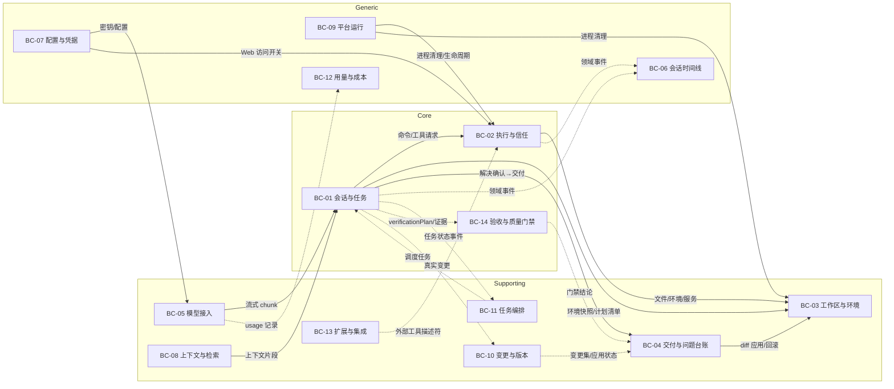

# 04 · 限界上下文（DDD Contexts）

> 阶段：战略 / Contexts
> 输入：[03 子域划分](03-subdomains.md) 的边界候选、[02 领域发现](02-discovery.md) 的事件流与热点
> 输出：上下文目录、通用语言词汇表、反术语清单、边界 ADR、语言演进规则

---

## 1. 上下文目录

| 编号  | 上下文                                                                 | 职责                                                                                                                     | 非职责                                                      | 核心术语                                                                                       | 主要事件                                                                                                     | 数据所有权                                                                                                                                                       | 代码落点                                                                                                                                                                                                                                                                                                               | Owner                |
| :---- | :--------------------------------------------------------------------- | :----------------------------------------------------------------------------------------------------------------------- | :---------------------------------------------------------- | :--------------------------------------------------------------------------------------------- | :----------------------------------------------------------------------------------------------------------- | :--------------------------------------------------------------------------------------------------------------------------------------------------------------- | :--------------------------------------------------------------------------------------------------------------------------------------------------------------------------------------------------------------------------------------------------------------------------------------------------------------------- | :------------------- |
| BC-01 | **会话与任务**（Conversation & Task）                                  | 承载会话消息、流式回合、目标/方案/解决决策点、单一 PENDING、拒绝原因、无进展保护、推进保障                               | 不执行工具、不直接读写文件、不管理 Provider 传输、不渲染 UI | 会话、消息、回合、任务、目标、方案、完成声明、证据、决策点、待决策、拒绝原因                   | `conversation.*`、`task.*`、`session.*`、`dialogue.*`、`decision.*`、`proposal.*`、`completion.*`、`stuck.*` | 会话消息 + 任务状态快照（localStorage V2 同一记录——ADR-013 跨重启）、决策内容快照                                                                                | `src/domain/conversationState.ts`、`agentLoop.ts`、`protocolTools.ts`、`planProposalParser.ts`、`completionClaimParser.ts`、`taskSnapshot.ts`（跨重启快照）、`timeline.ts`（事件派生）、`renderer/useConversationState.ts`、`useMessageStore.ts`/`sessionStore.ts`（V2 快照恢复）、`ConversationPanel.tsx`（应用编排） | 领域/产品 + 应用层   |
| BC-02 | **执行与信任**（Execution & Trust）                                    | 工具目录、权限规则、动作属性、沙箱路径、逐次授权、信任模式预设（三档）、低危委托边界、信任记忆、写前快照、回滚、进程取消 | 不决定目标/方案、不生成完成声明、不渲染确认卡               | 工具调用、工具结果、授权、批准、拒绝记忆、动作属性、只读/高危、计划内/清单外、沙箱、快照、回滚 | `tool.requested/executing/executed/failed/blocked/approved/rejected/remembered`                              | 工具清单（main 内存）、权限规则（main userData 持久化）、信任模式（main userData 持久化）、授权状态（renderer + main 镜像）、快照 `.nf-bak`、进程表（main 内存） | `src/main/tools.ts`、`permissionRulesStore.ts`、`trustPolicyStore.ts`、`serviceManager.ts`、`envManager.ts`（端口/进程）、`applyDiff.ts`、`domain/sandboxPath.ts`、`renderer/useToolApproval.ts`、`renderer/useTrustPolicy.ts`、`renderer/SettingsPanel.tsx`、`authModel.ts`                                           | 执行层/安全 + 应用层 |
| BC-03 | **工作区与环境**（Workspace & Environment）                            | 项目打开/初始化、文件树/只读查看、计划清单持久化、环境检测、能力清单、端口分配、开发服务器生命周期                       | 不执行模型对话、不做完成核验、不管理 Provider               | 项目根、工作区、文件、计划清单、产出、环境、能力、端口、服务                                   | `plan.approved/rejected`、`capability.checked/ledger_updated`、`environment.injected`                        | 项目目录、README/`.neonforge`、plannedFilesStore（main userData）、环境/端口注册表、服务注册表                                                                   | `src/main/workspace.ts`、`plannedFilesStore.ts`、`projectInit.ts`、`envManager.ts`、`serviceManager.ts`、`renderer/FileTree.tsx`、`OutputPanel.tsx`                                                                                                                                                                    | 执行层               |
| BC-04 | **交付与问题台账**（Delivery & Problem Ledger）                        | 交付包汇总、验收对照、diff 应用/回滚、问题 7 态、快照、复跑/关闭                                                         | 不决定任务状态、不执行工具、不核验证据                      | 交付包、产物、验收、下一步、复跑、问题、问题台账、状态、快照、关闭                             | `problem.created/rerun/snapshot_updated/closed`、交付/回滚 IPC                                               | 问题台账（localStorage，最多 20）、交付包（renderer state）、diff 应用快照                                                                                       | `src/renderer/types.d.ts`、`problemStore.ts`、`SessionPanel.tsx`、`DeliveryPanel.tsx`、`DigitalDeliveryPanel.tsx`（演示）、`DoDAlignPanel.tsx`（演示）、`MainWorkspace.tsx`                                                                                                                                            | 应用层/产品          |
| BC-05 | **模型接入**（Provider Gateway）                                       | 接入方描述、模型列表/手填/回退、flash/pro 档位、SSE 流、tool_call 修复、验证、重试、摘要、预热                           | 不决定任务状态、不执行工具、不渲染消息                      | 接入方、模型、档位、流式、reasoning、tool_call、验证、重试                                     | `gateway:*` IPC、`conversation.error`、`gateway:stream-chunk`                                                | Provider 描述符（静态）、解析后的模型映射（main 内存）、流状态（renderer 累积）                                                                                  | `src/main/providers/*`、`gateway.ts`、`preheat.ts`、`compact.ts`（摘要调用）                                                                                                                                                                                                                                           | 执行层/平台          |
| BC-06 | **会话时间线**（Session Timeline）                                     | 事件注册表、状态 diff 派生、JSONL append/query、聊天日志导出                                                             | 不拥有任务状态、不做业务决策、不保证强一致日志              | 时间线、事件、序号、会话、载荷、去重、聊天日志                                                 | 全部领域事件；`timeline:log/query`、`chat:log/export`                                                        | `timeline-<session>.jsonl`、`chat-<session>.jsonl`（userData/logs）                                                                                              | `src/domain/timeline.ts`、`src/main/timelineLogger.ts`、`chatLog.ts`                                                                                                                                                                                                                                                   | 平台                 |
| BC-07 | **配置与凭据**（Configuration & Secrets）                              | API Key、Provider/Model 选择、Web 访问开关/端点/Key、本机安全存储                                                        | 不发起模型请求、不执行工具、不决定任务                      | 接入方、模型 id、API Key、Web 访问、探测、本机存储                                             | `config:*` IPC                                                                                               | `userData/config/neonforge-config.json`（safeStorage 加密 + 明文 fallback 0600）                                                                                 | `src/main/configStore.ts`、`renderer/ConfigPage.tsx`、`SettingsPanel.tsx`                                                                                                                                                                                                                                              | 平台/安全            |
| BC-08 | **上下文与检索**（Context & Retrieval）                                | @mention 文件片段、CodeRAG、LSP 查询、压缩、标准前缀/预热                                                                | 不决定目标/方案、不执行副作用、不拥有会话状态               | 上下文片段、注入、检索、命中、符号、诊断、压缩、前缀、预热                                     | `context:resolve`、`rag:search`、`compaction:compact`、`preheat:status`                                      | 片段（瞬时）、RAG 命中（瞬时）、前缀缓存（main 内存）、LSP 进程                                                                                                  | `src/main/context.ts`、`codeRag.ts`、`lsp.ts`、`compact.ts`、`preheat.ts`                                                                                                                                                                                                                                              | 执行层               |
| BC-09 | **平台运行**（Platform Runtime）                                       | Electron 生命周期、单实例、窗口、进程清理、内置插件注册表                                                                | 不参与业务决策、不执行模型调用、不拥有业务数据              | 应用、窗口、单实例、生命周期、进程、插件                                                       | —                                                                                                            | 进程 PID 文件（userData）、插件注册表（main 内存）                                                                                                               | `src/main/main.ts`、`pluginSystem.ts`、`preload.ts`（桥）                                                                                                                                                                                                                                                              | 平台                 |
| BC-10 | **变更与版本**（Change & Version） `已落地 2026-11-14`              | 变更集、基线快照、差异、审核、应用、回滚、Git 只读桥                                                                     | 不决定任务完成、不执行工具、不管理队列                      | 变更集、变更项、基线、差异、应用、回滚、冲突、Git 状态                                         | `changeset.*`                                                                                                | 变更集记录、基线快照（`.nf-bak`/内容哈希）、Git 只读结果                                                                                                         | `src/domain/changeSet.ts`、`src/main/changeSetService.ts`、`src/main/gitBridge.ts`、`ipc.ts` `changeset:*`/`git:read`                                                                                                                                                                                                  | 执行层 + 应用层      |
| BC-11 | **任务编排**（Task Orchestration） `已落地 2026-11-14`              | 多任务入队、调度、阻塞/恢复、取消、队列视图                                                                              | 不决定目标/方案、不执行工具、不持有效证据                   | 任务条目、队列、排队、运行、阻塞、暂停、取消、优先级                                           | `queue.*`                                                                                                    | 队列状态（userData 本地 JSON）                                                                                                                                   | `src/domain/taskQueue.ts`、`src/main/taskQueueStore.ts`、`ipc.ts` `queue:*`、`MainWorkspace.tsx` TaskPanel                                                                                                                                                                                                             | 应用层               |
| BC-12 | **用量与成本**（Usage & Cost） `已落地 2026-11-14`                  | 记录 Provider 真实 usage、缓存命中、成本计算、预算提醒、导出                                                             | 不发起模型请求、不决定模型路由、不修改 Provider 响应        | 用量条目、token、缓存、价格表、成本、预算                                                      | `usage.*`                                                                                                    | 用量台账（userData 本地 JSON）                                                                                                                                   | `src/domain/usageLedger.ts`、`src/main/usageStore.ts`、`gateway.ts` usage 解析、`ipc.ts` `usage:*`                                                                                                                                                                                                                     | 平台/财务口径        |
| BC-13 | **扩展与集成**（Extensions & Integrations） `已落地 2026-11-14`     | 扩展注册/生命周期、MCP 连接、外部工具描述、Git 集成、信任边界                                                            | 不直接执行文件/进程操作（经 BC-02）、不决定任务状态         | 扩展、版本、类型、能力、信任、MCP 服务器、工具描述                                             | `extension.*`                                                                                                | 扩展注册表、连接状态、配置（userData）                                                                                                                           | `src/domain/extension.ts`、`src/main/pluginSystem.ts`、`src/main/mcpClient.ts`、`src/main/gitBridge.ts`、`ipc.ts` `extensions:*`/`mcp:*`                                                                                                                                                                               | 平台/安全            |
| BC-14 | **验收与质量门禁**（Acceptance & Quality Gate） `已落地 2026-11-14` | 验收标准来源、验收项、证据绑定、豁免、门禁判定、交付联动                                                                 | 不执行工具、不决定任务状态、不替代完成证据门                | 验收标准、验收项、来源、证据、豁免、门禁、结论                                                 | `acceptance.*`、`quality_gate.evaluated`                                                                     | 验收记录（随会话/交付持久化）                                                                                                                                    | `src/domain/acceptance.ts`、`src/main/acceptanceStore.ts`、`ipc.ts` `acceptance:*`、`DeliveryPanel.tsx` 门禁                                                                                                                                                                                                           | 领域/产品            |

> BC-10～BC-14 是 `00-domain-blueprint.md` 推导出的**目标态上下文**：字段/占位/文案证据先于实现存在，编号追加而不是插入，保持既有文档与代码引用的稳定性。五个上下文已于 2026-11-14 全部落地；表中 `已落地 2026-11-14` 标记取代原 `目标态` 标记。

### 1.1 上下文关系图

---

## 2. 通用语言词汇表

> 规则：一个术语在一个上下文中只能有一个含义；跨上下文同名不同义必须翻译。

| 术语                           | 定义                                                                         | 业务示例                                        | 所属上下文  | 同义词             | 反术语                     | 冲突处理                             |
| :----------------------------- | :--------------------------------------------------------------------------- | :---------------------------------------------- | :---------- | :----------------- | :------------------------- | :----------------------------------- |
| 会话（Session）                | 一次对话消息序列及其时间线文件；UUID 标识                                    | “上午那次做旅行手册的会话”                      | BC-01/BC-06 | 对话               | 任务、问题                 | 会话是容器；问题可跨会话复跑         |
| 消息（Message）                | 会话中的一条用户/搭档/系统/工具记录                                          | 用户：“帮我做个记账工具”                        | BC-01       | 对话条目           | 事件                       | 消息是 UI/上下文数据；事件是领域事实 |
| 回合（Turn）                   | 一次模型请求到 `done` 的完整流式周期，可包含多个工具调用                     | “第 3 轮它写了 index.html”                      | BC-01       | 轮次               | 阶段                       | 回合是执行单位；不映射旧“阶段”       |
| 任务（Task）                   | 会话内一次目标驱动的交付单元；聚合根 `ConversationState`                     | “修好登录页”                                    | BC-01       | 工作项             | 问题、会话、阶段           | 任务是状态机；问题是业务对象         |
| 目标（Goal）                   | 用户确认的一句话结果承诺                                                     | “做一个能发给朋友的旅行手册网页”                | BC-01       | 目标陈述           | 问题标题                   | 目标是完整 statement；问题标题可截断 |
| 方案（Plan）                   | 文件清单 + 摘要 + 假设 + 验证计划的提议                                      | “改 index.html、App.jsx，跑 npm run build 验证” | BC-01       | 执行方案           | 执行确认（旧名）、计划清单 | 方案是提议；计划清单是派生边界       |
| 完成声明（Completion Claim）   | 搭档声称“已达成”的结构化声明及证据                                           | “已实现，证据：ls index.html（通过）”           | BC-01       | 达成声明           | 解决、交付                 | 达成是模型声明；解决是用户确认       |
| 证据（Evidence）               | 真实验证命令、输出、是否通过；以及系统 diff 对账                             | `npm test` → passed=true                        | BC-01       | 验证证据           | 自述、保证                 | 只有系统可代跑只读命令才算系统证据   |
| 决策点（Decision Point）       | 等待用户决策的 `goal/plan/approval/resolution/system_clarify`                | “目标确认卡”                                    | BC-01       | 确认点             | 阶段、流程步骤             | 决策点是领域状态；卡是 UI            |
| 待决策（PENDING）              | 会话级单一挂起状态；非 none 时冻结一切工具                                   | 方案卡弹出时                                    | BC-01       | 挂起               | working、等待              | working 是模型流式；pending 是等用户 |
| 授权（Approval）               | 对某个具体副作用动作的执行许可                                               | “允许执行 npm install”                          | BC-02       | 批准               | 方案确认                   | 授权是动作级；方案确认是任务级       |
| 拒绝原因（Reject Reason）      | 用户拒绝决策点时给出的原因（方向/范围/复杂度/信息不足/修改/其他）            | “方向不对，我要的是网页不是桌面应用”            | BC-01       | 拒绝理由           | 沉默拒绝                   | 拒绝必须带原因（不变量 8）           |
| 工具调用（Tool Call）          | 模型请求执行一个工具的结构化调用                                             | `write {path:'index.html'}`                     | BC-02       | 工具请求           | 工具结果                   | 调用是意图；结果含 ok/error          |
| 工具结果（Tool Result）        | 工具执行后的结构化返回                                                       | `{ok:true,data:{file:'/…/index.html'}}`         | BC-02       | 执行结果           | 工具调用                   | 内层 `ok:false` 透传为外层失败       |
| 动作属性（Action Attribute）   | 工具调用的风险/边界属性：readonly/network-read/hazardous/in-plan/out-of-plan | `bash ls` → readonly                            | BC-02       | 动作分类           | 风险等级                   | 属性决定门控；与模型自评无关         |
| 计划清单（PlannedFiles）       | 由已确认方案派生、追加式合并的允许写入边界                                   | `[index.html, App.jsx]`                         | BC-03       | 批准清单           | 产出、文件树               | 计划 ≠ 实际产出                      |
| 产出（ProducedFiles）          | write/edit 成功累积的真实文件集合                                            | `index.html` 已写入                             | BC-03       | 已产出             | 计划清单                   | 产出是事实；计划是边界               |
| 沙箱（Sandbox）                | 项目根目录；路径基准与信任边界（非 OS 级隔离）                               | rootPath=/Users/x/Documents/NeonForge/travel    | BC-02/BC-03 | 项目根、工作区边界 | 虚拟机、容器               | 沙箱外写入可逐次授权；read 无沙箱    |
| 环境（Environment）            | 项目 runtime/包管理器/工具链/端口的事实快照                                  | node v20、npm、vite                             | BC-03       | 项目环境           | 能力                       | 环境是事实；能力是语义视图           |
| 能力（Capability）             | 达成目标所需的抽象能力                                                       | `node-runtime`、`spreadsheet`                   | BC-03       | 能力视图           | 工具、依赖                 | 能力可多实现；工具是实现通道         |
| 服务（Service）                | NeonForge 管理的开发服务器实例，按 rootPath 唯一                             | vite 起在 5190                                  | BC-03       | 开发服务器         | bash 后台进程              | 只停自己起的                         |
| 交付包（Delivery Package）     | 产物 + 人话摘要 + 验收对照 + 下一步 + 复跑入口                               | “已整理 6 个文件”                               | BC-04       | 交付结果           | 完成声明、解决             | 交付包是系统汇总；声明是模型说的     |
| 问题（Problem）                | 用户要解决的事情；台账一等公民，7 态                                         | “发票整理”                                      | BC-04       | 问题实例           | 任务、会话                 | 问题可复跑/关闭；任务是一次执行      |
| 问题台账（Problem Ledger）     | 问题实例列表 + 断点快照                                                      | 左侧“问题”列表                                  | BC-04       | 台账               | 会话历史                   | 一个会话可承载多个问题               |
| 接入方（Provider）             | 模型服务的接入配置：baseURL、鉴权、模型列表                                  | DeepSeek 官方                                   | BC-05       | Provider、通道     | 模型、档位                 | 接入方是通道；模型是上游 id          |
| 档位（Model Tier）             | 产品抽象的两个档位：flash/pro                                                | flash 用于日常，pro 用于高思考                  | BC-05       | 档位               | 模型名                     | 档位映射到上游具体 id                |
| 时间线（Timeline）             | 按 ts+seq 排序的领域事件 JSONL                                               | `decision.resolved` 记录                        | BC-06       | 事件日志           | 聊天日志、埋点             | 时间线是超集；聊天日志是子集         |
| 上下文片段（Context Fragment） | @mention 注入的文件内容片段                                                  | `@App.tsx`                                      | BC-08       | 注入片段           | 检索命中                   | 注入是确定性读取；RAG 是检索兜底     |
| 压缩（Compaction）             | 长对话摘要 + 保留最近 20 条                                                  | 100 条后压缩                                    | BC-08       | 摘要               | 截断                       | 压缩保留语义；截断丢语义             |
| 预热（Preheat）                | 标准前缀构建 + 前缀缓存 + 最小成本 API 预热                                  | 打开项目后预热                                  | BC-08       | 前缀缓存           | 缓存命中                   | 预热是首请求成本优化                 |

**术语冲突处理原则**：

- 同名不同义：以“上下文.术语”限定，如 `BC-01.方案` vs `BC-02.授权`。
- 跨上下文引用必须翻译：例如 BC-02 的 `ToolResult` 进入 BC-01 时只保留 `ok/needApproval/policy/file` 四个字段，不暴露 `data` 细节。
- 旧名与新名并存：新文档、新代码、新 Spec 使用新名；旧名仅作为兼容层，标注弃用窗口。

---

## 3. 反术语清单

| 禁用词/反术语                                           | 禁用原因                                                                                    | 推荐替代                                                 |
| :------------------------------------------------------ | :------------------------------------------------------------------------------------------ | :------------------------------------------------------- |
| 阶段（Stage）/ 流程阶段                                 | 2026-08-07 已移除阶段体系；用阶段描述任务会误导状态设计                                     | 任务、决策点、回合                                       |
| `executionConfirmed` / “执行确认”                       | 旧状态名，当前语义是“方案确认”；事件名 `task.execution_*` 是遗留                            | `planConfirmed` / 方案确认 / `PlanConfirmed`             |
| `achievementConfirmed` / “达成确认”                     | 旧状态名，当前语义是“解决确认”；模型只能“声明达成”                                          | `resolutionConfirmed` / 解决确认 / `ResolutionConfirmed` |
| `forceTool` / “强制工具”                                | 旧推进策略名，当前统一为 `decideProgressGuarantee` 的 `require-action/require-advance/auto` | 推进保障模式                                             |
| `plan_approval`                                         | 旧工具名，已改为 `approve-files`；且它表达的是批量授权，不是方案确认                        | `approve-files` / 文件清单批准                           |
| `classifyAction`                                        | 已移除的兼容壳；当前是 `classifyReadonly` + `isSideEffectAction`                            | `classifyReadonly` / 动作属性                            |
| Manager / Processor / Handler / Agent（作为用户可见词） | 泛化技术词，污染通用语言；用户不需要理解                                                    | 搭档、任务、方案、决策点                                 |
| 任务队列（作为用户可见承诺）                            | 用户可见文案曾把占位描述成能力；领域内 `TaskQueueEntry` 已是真实聚合（BC-11，2026-11-14）   | 用户侧称“任务/问题台账”；领域内可用“任务队列”            |
| Demo / 演示数据（作为产品语义）                         | 演示面板不是生产能力；混入领域文档会误导                                                    | 原型/演示（显式标记）                                    |
| 坑 N / ticket N / S1…S7                                 | 内部开发编号，不是领域语言                                                                  | 用业务规则或 ADR 描述                                    |
| V1 / V2 / V3（作为领域状态）                            | 版本号不是业务状态                                                                          | 能力状态、兼容状态                                       |
| “大模型”/“AI 模型”在内核语言中                          | 用户侧可以这样说，但领域模型应使用接入方/模型/档位                                          | 接入方、模型、档位                                       |
| “批准方案”                                              | 与“批准文件清单”混淆                                                                        | 确认方案 / 批准文件清单                                  |

---

## 4. 边界 ADR

### ADR-D01：单一 PENDING + 五类决策点

- **决策**：会话同时只允许一个 `pending`（`none` 或五类决策点之一）；决策点按 `goal > plan > approval > resolution` 优先级派生，`system_clarify` 是系统触发的包装决策点。
- **理由**：避免多个确认卡互相插队、用户不知道先点哪个；保证“用户决策是唯一推进输入”。
- **权衡**：模型不能在一次回合里同时请求多个决策；需要 `suspendRound` 机制丢弃同轮兄弟工具。
- **风险**：优先级派生可能掩盖低优先级决策；当前通过 `decisionContent` 快照和事件审计缓解。
- **备选方案**：多个独立布尔标志（已拒绝）；按 UI 卡栈管理（无法保证状态一致）。
- **代码**：`conversationState.ts`（`deriveDecisionPoint`、`setPending`）；测试 `Inv 2/Inv 7`。

### ADR-D02：方案清单是写边界，且只由已确认方案派生

- **决策**：`plannedFiles` 只由已确认的 `PlanProposal.files` 或 `approve-files` 批准追加；write 清单外拒绝；编辑现有文件在方案确认后可豁免 `approve-files`。
- **理由**：把“写哪些文件”从模型自由发挥变成用户可见、可批准的边界；减少授权疲劳。
- **权衡**：模型首次定位文件可能不在清单内；需要 `approve-files` 补充或改写清单内文件。
- **风险**：相对/绝对路径双形态导致完成核验死锁；已用 `matchesPlannedPath` 末段匹配缓解。
- **备选方案**：每次写入逐次授权（已拒绝，授权疲劳）；完全信任模型（不安全）。
- **代码**：`conversationState.ts`（`derivePlannedFiles`、`inPlannedFiles`）；`tools.ts`（`ToolRegistry.execute`）。

### ADR-D03：完成证据门——至少一条系统可代跑只读命令

- **决策**：完成声明必须包含非空 `verification`，且至少一条命令被 `classifyReadonly` 判为 `readonly` 或 `network-read`；系统会代跑这些命令并核对输出；`unverifiable` 只标注不阻塞；`pendingQuestions` 不阻塞。
- **理由**：把“模型自报完成”降级为“系统复核 + 用户确认”；防止虚报。
- **权衡**：某些真实工作无法用只读命令证明（如 UI 视觉）；这类证据只能标 unverifiable，可能导致证据不足。
- **风险**：只读命令本身可能泄漏数据（外网 GET）；命令判定启发式可能误判。
- **备选方案**：只信任模型自报（已拒绝）；引入截图/浏览器自动化验证（未来）。
- **代码**：`conversationState.ts`（`verifyCompletion`、`buildEvidenceBackfill`）；`verification.ts`（`runOne`）；测试 `Inv 4`、`verifyCompletionSystem.test.ts`。

### ADR-D04：双层门控——SessionGate 优先于 ActionGate

- **决策**：先判会话状态（pending / 目标 / 方案 / 清单），再判动作属性（只读/网络/清单内/高危）；`pending` 冻结一切工具，包括只读；`ask` 不直接拒绝，交给执行层授权卡。
- **理由**：状态门保证“用户没决策前绝不继续”；动作门保证“副作用有边界”。
- **权衡**：只读工具在 pending 时也被冻结，可能让模型无法继续分析；这是有意的“无害≠有用”。
- **风险**：renderer 与 main 镜像不同步会导致门失效；已有 `session:plan-confirmed`、`planned-files` 同步。
- **备选方案**：只在执行层做一次门控（renderer 可被绕过）；只做 renderer 门控（main 无防线）。
- **代码**：`conversationState.ts`（`sessionGate`/`actionGate`/`canExecute`）；`tools.ts`（`ToolRegistry.execute`）；测试 `Inv 3`。

### ADR-D05：项目根是软沙箱与信任边界，不是 OS 隔离

- **决策**：项目根用于路径解析、信任记忆、open 本地文件限制；write/edit 沙箱外仍可在逐次人工授权下执行；read 不受沙箱限制。
- **理由**：非技术用户需要“局部安全 + 可控越界”，而不是容器/虚拟机；读取项目外文件有时是合理需求（如整理 Downloads）。
- **权衡**：软边界依赖用户判断；read 无边界带来隐私风险。
- **风险**：符号链接逃逸、`read` 读取敏感文件、模型将文件内容发给 provider。
- **备选方案**：硬沙箱（chroot/容器，桌面端成本高）；read 也强制沙箱（会破坏文件整理场景）。
- **代码**：`tools.ts`（`resolvePath`/`isInSandbox`）；`conversationState.ts`（`classifyReadonly`）；`sandboxPath.ts`（`resolveSandboxPath`）。

### ADR-D06：接入方描述符 + OpenAI 兼容传输

- **决策**：接入方用纯数据 `ProviderDescriptor` 描述；传输统一走 `fetch` + SSE；模型档位 `flash/pro` 由 `/models` 列表、手填、fallback 三级解析。
- **理由**：新增接入方只需加 descriptor + 注册，不写新协议；保持领域层纯净。
- **权衡**：各 provider 的行为差异（thinking、tool_choice、region gate）需要 profile/补丁；当前 DeepSeek profile 特化。
- **风险**：上游模型命名变化、区域限制、tool_call 格式漂移。
- **备选方案**：每 provider 独立 SDK（维护成本高）；只支持一家（锁定风险）。
- **代码**：`providers/types.ts`、`providers/registry.ts`、`transport/openaiCompat.ts`、`gateway.ts`（`refreshModels`）。

### ADR-D07：时间线是状态 diff 派生的事件日志（Event Sourcing-lite）

- **决策**：领域事件由 `deriveStateEvents(prev, next)` 在唯一转换点自动派生；事件目录必须在 `TIMELINE_EVENT_SPECS` 注册；时间线 append 到 JSONL，支持 query。
- **理由**：避免散落打点；状态转换与事件一致；可回放诊断。
- **权衡**：事件是派生事实，不是持久化事件源；日志写失败有计数与 DLQ（P1-02），但不能保证强一致审计。
- **风险**：未注册事件只 warn；跨进程事件顺序依赖调用时序；事件已有 `eventId`/`version`（P2-07）与去重（P2-06）；轻量 Outbox（2026-11-15）保证已进入 `logTimeline` 的事件先入队 fsync、失败保留并启动重放（`outboxId` 幂等）；跨存储事务投递仍无保证。
- **备选方案**：每个组件手写打点（已拒绝）；完整 Event Sourcing + 事件存储（当前过重）。
- **代码**：`timeline.ts`（`deriveStateEvents`/`TIMELINE_EVENT_SPECS`）；`timelineLogger.ts`（`logTimeline`）；`useConversationState.ts`。

### ADR-D08：三类持久化分工

- **决策**：计划清单/批准事实由 main `plannedFilesStore` 落 userData（权威）；会话消息与问题台账由 renderer localStorage；时间线/聊天日志由 main JSONL。
- **理由**：跨进程可恢复、跨重启保留、崩溃后可读；避免把权威状态放在易失的 renderer。
- **权衡**：三套存储各自容错，可能出现局部恢复不一致；localStorage 有配额/清理风险。
- **风险**：store 损坏回退空清单；localStorage 不可用；日志写失败静默。
- **备选方案**：统一 SQLite（未来）；全部放 main（renderer 断点恢复复杂）。
- **代码**：`plannedFilesStore.ts`、`sessionStore.ts`、`problemStore.ts`、`timelineLogger.ts`。

### ADR-D09：变更集以基线 + 快照为一致性边界（已落地 2026-11-14）

- **决策**：文件变更组织为 `ChangeSet`；每个变更项记录应用前基线（哈希 + 快照引用）；应用必须用户审核授权，回滚恢复基线。
- **理由**：没有基线与变更集，diff 应用/回滚只是 UI 动作，无法证明“改了什么、基于什么、能否安全恢复”。
- **权衡**：需要额外存储基线/哈希，文件变更成本上升；大文件需限制快照策略。
- **风险**：外部修改导致冲突；快照存储增长；Git 集成只是只读桥，不等于版本控制所有权。
- **备选方案**：只保留 `.nf-bak`（V1 曾为现状，无法表达变更集）；直接交给 Git（非 Git 项目不适用）。
- **代码**：`applyDiff.ts`（snapshot/revert）、`domain/changeSet.ts`、`main/changeSetService.ts`、`main/gitBridge.ts`、`ipc.ts` `changeset:*`/`git:read`。

### ADR-D10：任务队列独立于 Task 聚合（已落地 2026-11-14）

- **决策**：多任务编排放在 BC-11；Task 聚合只负责单个任务的状态机；队列通过 Task 状态事件驱动。
- **理由**：把队列塞进 `ConversationState` 会破坏“单一 PENDING/单一任务边界”不变量；队列是调度关注点，不是任务一致性关注点。
- **权衡**：需要新的持久化与调度器；跨进程协调复杂度增加。
- **风险**：队列状态与 Task 状态漂移；阻塞任务饿死；取消竞态。
- **备选方案**：单任务（V1 曾为现状；BC-11 已落地）；队列放 renderer 内存（重启丢失）。
- **代码**：`domain/taskQueue.ts`、`main/taskQueueStore.ts`、`ipc.ts` `queue:*`、`MainWorkspace.tsx` TaskPanel。

### ADR-D11：用量只记录 Provider 真实 usage（已落地 2026-11-14）

- **决策**：`UsageLedger` 只接受 Provider 返回的 usage 字段；缺失时记 `unknown`；成本用版本化价格表；台账不含内容/密钥。
- **理由**：字符估算不是计费事实；未知成本不能当 0；隐私要求台账不可反推 prompt。
- **权衡**：部分 Provider 不返回 usage → 用量不完整；价格表需要维护。
- **风险**：模型改名/价格变化；跨币种；缓存命中口径不一致。
- **备选方案**：字符估算（当前 `compact.ts` 的近似，仅用于压缩触发）；按订阅固定价（不适用于多 Provider）。
- **代码**：`domain/usageLedger.ts`、`main/usageStore.ts`、`gateway.ts` usage 解析、`ipc.ts` `usage:*`/`budget:*`/`pricing:*`。

### ADR-D12：扩展能力必须经过 BC-02 的授权/沙箱（已落地 2026-11-14）

- **决策**：扩展只提供能力描述与受控调用入口；实际文件/进程/网络操作仍走 BC-02 工具目录与门控；第三方扩展首次调用需用户授权。
- **理由**：避免插件成为绕过授权与沙箱的后门；保持安全边界单源。
- **权衡**：扩展接入成本增加；部分 MCP 工具语义需要映射到风险等级。
- **风险**：MCP 服务器被恶意替换；能力描述与实际行为不符；扩展生命周期失败。
- **备选方案**：扩展直接执行任意代码（拒绝）；只允许内置扩展（能力受限）。
- **代码**：`domain/extension.ts`、`main/pluginSystem.ts`、`main/mcpManager.ts`、`ipc.ts` `extensions:*`/`mcp:*`/`git:read`。

### ADR-D13：验收来源优先方案验证计划，门禁判定单源（已落地 2026-11-14）

- **决策**：验收项优先从已确认方案的 `verificationPlan` 派生，其次用户 DoD/手工；无来源时显式为空；门禁判定由 `AcceptanceRecord` 单源计算。
- **理由**：验收必须有出处；避免 UI 勾选绕过证据；演示 DoD 不得进入生产路径。
- **权衡**：方案未提供验证计划时验收为空，需要用户补充；手工验收需要理由。
- **风险**：验收项与完成证据语义重叠（需明确：证据回答“做到没有”，验收回答“按什么标准算做到”）；豁免滥用。
- **备选方案**：只靠完成证据门（V1 曾为现状，交付包验收为空）；UI 勾选即通过（不可信）。
- **代码**：`domain/acceptance.ts`、`main/acceptanceStore.ts`、`ipc.ts` `acceptance:*`、`DeliveryPanel.tsx` 门禁、`PlanProposal.verificationPlan`。

---

## 5. 语言演进规则

1. **新增术语**：任何新术语必须先在 04 的词汇表登记，注明所属上下文、定义、业务示例、反术语；未登记术语不得进入 09 的 proposal/spec。
2. **变更术语**：变更必须走 ADR；旧术语进入弃用清单，保留至少一个发布窗口的兼容别名。
3. **评审角色**：领域/产品（语义）、应用层（使用方）、执行层（实现方）、安全（若涉及授权/数据边界）。
4. **版本策略**：文档术语表随代码 commit 演进；事件名与 IPC 契约采用“新增字段优先、旧字段保留”的兼容策略；破坏性重命名必须提供迁移说明。
5. **跨上下文翻译**：同一个词在不同上下文含义不同时，必须在 05 的 ACL 表中登记翻译规则。
6. **禁止词**：反术语清单中的词不得出现在新的领域文档、Spec Scenario、领域层代码命名中；旧代码中的反术语在 08 中列为命名债。

---

## 6. 校验清单

- [x] 每个上下文有明确的“职责”与“非职责”
- [x] 数据所有权无冲突；跨上下文访问必须通过契约/翻译
- [x] 每个上下文至少有 1 条显式的权衡点与风险点（ADR）
- [x] 术语冲突已全部处理（翻译或重命名）
- [x] 反术语清单覆盖技术词污染与模糊业务词
- [x] 若引入“需求/意向”类中间概念（如 PlanProposal、CompletionClaim），已声明其与主聚合的生命周期关系（值对象 vs 独立聚合），并以 ADR 记录
- [x] 通用语言词汇表覆盖 01 的 25 个术语种子，并补充上下文专属术语
