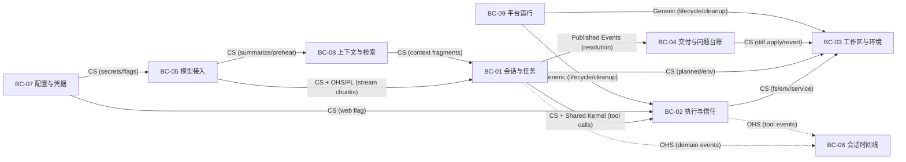

# 05 · 上下文映射（DDD Context Map）

> 阶段：战略 / Context Map
> 输入：[04 限界上下文](04-bounded-contexts.md) 的上下文目录、[02 领域发现](02-discovery.md) 的跨边界热点
> 输出：关系矩阵、集成模式、契约所有权、翻译/ACL 决策、失败模式、版本策略

---

## 1. 上下文关系矩阵

| 编号 | 上游 | 下游 | 集成模式 | 数据 / 事件流向 | 风险 | 契约 Owner |
| :--- | :--- | :--- | :--- | :--- | :--- | :--- |
| M01 | BC-05 模型接入 | BC-01 会话与任务 | **Customer-Supplier + OHS/PL** | SSE `reasoning/content/tool-call/done/stream-reset` → renderer 流式累积 | 上游格式漂移、区域限制、tool_call 截断 | BC-05 |
| M02 | BC-01 会话与任务 | BC-02 执行与信任 | **Customer-Supplier + Shared Kernel** | 工具调用、授权请求、拒绝记忆；共享 `classifyReadonly`、`ActionAttribute`、`resolveSandboxPath` | Shared Kernel 改动会同时影响两端；domain 模块无运行时隔离 | BC-01 / BC-02 共同 |
| M03 | BC-02 执行与信任 | BC-03 工作区与环境 | **Customer-Supplier** | 文件读写、环境快照、端口分配、服务生命周期；`ToolResult` 回传 | 路径/端口/进程边界；沙箱外写入 | BC-02 |
| M04 | BC-01 会话与任务 | BC-03 工作区与环境 | **Customer-Supplier** | `plannedFiles` 派生与持久化、`check-capability` 环境快照、项目初始化 | 相对/绝对路径双形态；计划清单与文件树不一致 | BC-03 |
| M05 | BC-01 会话与任务 | BC-04 交付与问题台账 | **Published Events / Conformist** | `resolutionConfirmed`、真实文件变更 → 交付包；问题快照更新 | 交付包可能由模型声明而非真实产物驱动；验收项可能为空 | BC-04 |
| M06 | BC-04 交付与问题台账 | BC-03 工作区与环境 | **Customer-Supplier** | `delivery:apply-diff` / `delivery:revert-diff`；快照 | diff 过期、目标文件被外部修改、回滚失败 | BC-03 |
| M07 | BC-01 / BC-02 | BC-06 会话时间线 | **Event-Driven OHS** | 领域事件 append；timeline query | 日志写失败静默；事件顺序依赖调用时序；未注册事件只 warn | BC-06 |
| M08 | BC-08 上下文与检索 | BC-01 会话与任务 | **Customer-Supplier** | @mention 片段、RAG 命中、LSP 符号/诊断、压缩摘要、预热前缀 | 片段截断、检索降级、LSP 不可用 | BC-08 |
| M09 | BC-05 模型接入 | BC-08 上下文与检索 | **Customer-Supplier** | `summarize` 摘要、`preheat` 预热请求 | Provider 不可用时压缩/预热降级 | BC-05 |
| M10 | BC-07 配置与凭据 | BC-05 / BC-02 | **Customer-Supplier** | API Key、Provider/Model、Web 访问开关/端点/Key | 密钥泄漏；明文 fallback；配置变更未热更新 | BC-07 |
| M11 | BC-09 平台运行 | 全部 | **Generic / Conformist** | 应用生命周期、单实例、进程清理、插件注册表 | 进程清理误杀（pid=0）；退出时业务状态未持久化 | BC-09 |
| M12 | BC-11 任务编排 | BC-01 会话与任务 | **Customer-Supplier + OHS 双向**（目标态） | 队列命令（入队/启动/暂停/取消）→ Task；Task 状态事件（blocked/completed）→ 队列 | 队列状态与 Task 状态漂移；阻塞任务饿死 | BC-11 |
| M13 | BC-01 会话与任务 | BC-14 验收与质量门禁 | **Customer-Supplier**（目标态） | `PlanProposal.verificationPlan`、完成证据、解决确认 → 验收项/门禁输入 | 验收来源为空；证据与验收项错配 | BC-14 |
| M14 | BC-14 验收与质量门禁 | BC-04 交付与问题台账 | **Published Events**（目标态） | 门禁结论、验收项状态 → 交付包，关闭前置 | 门禁未通过但交付被关闭 | BC-14 |
| M15 | BC-01 / BC-02 | BC-10 变更与版本 | **Customer-Supplier + Shared Kernel**（目标态） | 真实 write/edit 变更、快照、diff → 变更集；变更集状态回传 | 缺基线；外部修改冲突；快照丢失 | BC-10 |
| M16 | BC-10 变更与版本 | BC-04 交付与问题台账 | **Customer-Supplier**（目标态） | 变更集摘要、应用/回滚状态 → 交付包与问题台账 | 交付引用过期变更集 | BC-10 |
| M17 | BC-05 模型接入 | BC-12 用量与成本 | **Event-Driven OHS**（目标态） | Provider usage、缓存结果 → 用量台账；成本/预算 → UI/审计 | usage 缺失；成本未知；口径漂移 | BC-12 |
| M18 | BC-13 扩展与集成 | BC-02 执行与信任 | **ACL + Customer-Supplier**（目标态） | 外部工具描述符、能力调用 → 工具目录/门控；结果回传 | 能力绕过授权；MCP 服务器不可信 | BC-02 / BC-13 |

### 1.1 关系图

---

## 2. 契约所有权矩阵

| 契约 | 形式 | Owner | 消费者 | 变更流程 | 发布策略 |
| :--- | :--- | :--- | :--- | :--- | :--- |
| `gateway:stream-chat` + `gateway:stream-chunk` | IPC invoke + main→renderer 事件 | BC-05 | BC-01、BC-08 | 先加字段；chunk 类型只增不删；变更需回放测试 | 随桌面应用整体发布；无外部消费者 |
| `tools:execute` + `ToolResult` | IPC invoke | BC-02 | BC-01、useToolApproval | 字段新增优先；`needApproval`/`policy` 结构化字段不可退回文本匹配 | 同上 |
| `planned-files:load/add/reset` | IPC invoke | BC-03 | BC-01 | 追加语义不变；`approved` 布尔语义不变 | 同上 |
| `session:plan-confirmed` | IPC invoke | BC-02（门控镜像） | BC-01 | 只接受 boolean；与 `planConfirmed` 语义同步 | 同上 |
| `completion:verify` | IPC invoke | BC-02/BC-03 | BC-01 | 只接受只读命令；返回 `Record<command,{ok,output}>` | 同上 |
| `delivery:apply-diff` / `revert-diff` | IPC invoke | BC-04/BC-03 | BC-04 | diff 解析格式固定；`approved` 必填 | 同上 |
| `timeline:log` / `timeline:query` | IPC invoke | BC-06 | BC-01、BC-02、BC-04 | 事件 type 必须先在 `TIMELINE_EVENT_SPECS` 注册；detail 字段宽松 | 同上 |
| `config:*` | IPC invoke | BC-07 | BC-05、BC-02、UI | 字段新增优先；密钥明文字段只在本机 UI 回填 | 同上 |
| `context:resolve` / `rag:search` / `compaction:compact` / `preheat:status` | IPC invoke | BC-08 | BC-01、UI | 返回结构稳定；降级用 `ok:false` | 同上 |
| `ProviderDescriptor` | TypeScript 纯数据 | BC-05 | BC-05、BC-07、UI | 新增接入方 = 新增 descriptor + 注册；不改传输 | 同上 |
| `PROTOCOL_TOOL_DEFS` | TypeScript 常量 / JSON Schema | BC-01 | BC-05、BC-01 | schema 与提示词同步；新增字段需参数校验同步 | 同上 |
| `TIMELINE_EVENT_SPECS` | TypeScript 常量 | BC-06 | 全部 | 新增事件三步：注册 → emit → 测试 | 同上 |
| `NeonForgeBridge` | `preload.ts` + `types.d.ts` | BC-09/BC-02 | renderer | 类型与实现同步；无生成式 schema（见 08） | 同上 |
| `changeset:*`（目标态） | IPC invoke | BC-10 | BC-04、UI | 变更集状态机；应用必须带 approved；回滚必须带 changeId | 随应用发布 |
| `queue:*`（目标态） | IPC invoke + 事件 | BC-11 | BC-01、UI | 队列条目状态只由调度器变更；Task 状态事件为唯一事实源 | 随应用发布 |
| `usage:*`（目标态） | IPC query/export | BC-12 | UI、审计 | 只读台账；导出脱敏；价格表版本字段只增 | 随应用发布 |
| `extensions:*`（目标态） | IPC invoke | BC-13 | BC-02、UI | 能力描述符需版本；第三方扩展首次调用需授权 | 随应用发布 |
| `acceptance:*`（目标态） | IPC invoke | BC-14 | BC-04、UI | 验收项来源必填；passed 必须带 evidenceRef；waive 必须带 reason | 随应用发布 |

---

## 3. 翻译与 ACL 决策

| 编号 | 上游对象/事件 | 下游对象/事件 | 翻译规则 | 语义差异 | 实现位置 |
| :--- | :--- | :--- | :--- | :--- | :--- |
| T01 | Provider SSE `delta.reasoning_content` / `delta.content` / `delta.tool_calls` | Gateway chunk `reasoning/content/tool-call` | 字段解包；tool_calls 按 `index` 累积；JSON 参数修复 | 上游可能分片、畸形、重复 | `gateway.ts:665-747` |
| T02 | OpenAI `tool_call.function.arguments`（JSON 字符串） | `ToolCallView.args`（对象） | `toolCallRepair` 4 轮：直接 parse → 双重序列化剥层 → 尾逗号补全 → 首个 JSON 值提取 | 模型可能混入说明文本 | `gateway.ts:103-128` |
| T03 | 旧文本标记 `【目标确认】/【执行方案】/【已达成】` | `proposal.goal/plan/completion` | 仅在工具不可用时降级；不构造决策点，注入引导让模型改用协议工具 | 文本是降级通道，不是主通道 | `ConversationPanel.tsx:971-1144`、`sysPrompt.ts` |
| T04 | 模型路径 `index.html` / `任务目录/index.html` / 绝对路径 | 统一 `trustPath` 基准 | `resolveSandboxPath` 剥误带前缀；`matchesPlannedPath` 末段匹配 | 相对/绝对双形态 | `sandboxPath.ts:13-25`、`conversationState.ts:783-798` |
| T05 | 事件 `task.execution_confirmed` / `task.achievement_confirmed` | 领域语义 `planConfirmed` / `resolutionConfirmed` | 事件名保留旧名；文档与 UI 使用新语义；后续版本重命名 | 历史命名债 | `timeline.ts:134-142`、`conversationState.ts:112-115` |
| T06 | `ProblemStatus` 7 态 | UI 中文标签 | `understanding/awaiting-plan/executing/awaiting-input/delivered/closed/failed-recoverable` → 理解中/方案待确认/执行中/待你操作/已交付/已关闭/失败可恢复 | UI 标签不是领域枚举 | `SessionPanel.tsx:6-14` |
| T07 | `DeliveryPackage` | 产物区视图 | status/summary/artifacts/acceptance/nextSteps/diffs 直接映射；演示注入与真实变更分离 | 演示数据不得进入生产 | `types.d.ts:202-216`、`MainWorkspace.tsx:282-299` |
| T08 | `chatLog` 条目 | 时间线/导出视图 | 聊天日志是时间线子集；错误与工具名摘要额外记录 | 两者不是同一存储 | `chatLog.ts:8-15`、`timelineLogger.ts:1-7` |
| T09 | Provider 验证错误 `key-invalid/service-error/timeout/network/region-blocked/http-*` | UI 错误类型 `key-invalid/service/unknown` | `classifyGatewayError` + `classifyChatError` 兜底 | 验证错误比聊天错误更细 | `gateway.ts:77-84`、`errorClassify.ts:9-24` |
| T10 | Main `needApproval` / `policy` 结构化结果 | Renderer 工具卡状态 | `needApproval` → 授权卡；`policy` → 策略引导（不置 `lastToolFailed`） | 不能再用文本 `includes('授权')` | `tools.ts:88-98`、`ConversationPanel.tsx:1590-1610` |

---

## 4. 失败模式与缓解

| 编号 | 集成点 | 失败模式 | 影响 | 检测方式 | 缓解措施 | 补偿策略 |
| :--- | :--- | :--- | :--- | :--- | :--- | :--- |
| F01 | M01 Provider SSE | 400 一次 / 5xx / 超时 / 网络中断 | 流中断、工具调用丢失 | `GatewayHttpError` / `DOMException` / `TypeError` | 3 次重试；`stream-reset` 丢弃半截流；400 只重试一次 | 用户“重试”重放回合；key-invalid → 配置页 |
| F02 | M01 Provider | 模型 tool_call JSON 畸形 | 工具无法执行 | `toolCallRepair` 返回 null | 4 轮修复；失败跳过并记录 | 模型下一轮重试；audit 日志 |
| F03 | M02 工具执行 | `pending` 非 none 时模型仍调工具 | 越权执行 | `sessionGate` | 拒绝 + 引导；`suspendRound` 丢弃同轮兄弟工具 | 用户决策后重试 |
| F04 | M02 工具执行 | 只读判定误判（`sed -i`/`find -exec` 等） | 未授权写入/删除 | 规则审计 / 安全测试 | 补充危险参数形态；fail-closed | 回滚快照；安全事件记录 |
| F05 | M03 文件系统 | 路径双重嵌套 / 相对绝对不一致 | ENOENT、批准清单失效 | `resolveSandboxPath` / `matchesPlannedPath` | 路径规范化 + 末段匹配 | 重新 approve-files |
| F06 | M03 文件系统 | 符号链接逃逸 / 沙箱外写入 | 越界访问 | 当前仅字符串前缀判断（缺口） | realpath 解析 + 逐次授权 | 回滚/人工检查 |
| F07 | M03 服务 | 端口冲突 / 命令失败 / 进程残留 | 服务不可用、端口占用 | `waitForUrl` / 端口注册表 / PID 文件 | 显式端口分配、保留端口保护、进程组 kill | 换端口/换命令；应用退出清理 |
| F08 | M04 计划清单 | 方案未确认就写入 `plannedFiles` | 拒绝方案的文件残留、后续越界 | 不变量 6 测试（当前渲染层有违反点） | 只在确认时派生；拒绝不落清单 | 任务边界重置 |
| F09 | M05 交付 | 交付包由模型声明而非真实产物驱动 | 用户看到虚假交付 | `realChanges` 为空但 delivery 有值 | 交付包只从真实 write/edit 变更生成 | 重新执行/回滚 |
| F10 | M06 Diff | diff 过期 / 文件被外部修改 | 应用失败或覆盖 | `applyDiffToFile` 读取当前内容 | 应用前快照；失败返回错误 | 回滚；重新生成 diff |
| F11 | M07 时间线 | 日志写失败被静默吞掉 | 审计缺失 | 无显式检测（缺口） | 失败计数/错误事件；日志目录可写检查 | 本地 console/备用日志 |
| F12 | M08 检索 | LSP 不可用 / CodeRAG 扫描上限 | 检索降级 | `LspService` 错误 / `hits` 空 | 文本扫描兜底；提示无项目 | 继续 read/search |
| F13 | M09 压缩 | 压缩失败/摘要为空 | 上下文超限 | `compaction.compact` 返回 `ok:false` | 全量发送降级；用户可见提示 | 手动新会话 |
| F14 | M10 配置 | safeStorage 解密失败 / 明文 fallback | Key 可用但安全性降低 | `getApiKey` fallback | 0600 权限；本机明文 fallback | 重新输入 Key |
| F15 | M11 平台 | `pid=0` 时 `kill(-0)` | 误杀当前进程组/应用 | 当前代码无 pid>0 守卫（缺口） | 加 `pid > 0` 守卫 | 重启应用 |
| F16 | M11 平台 | 应用崩溃/强制退出 | 计划清单/信任/会话部分丢失 | 重启恢复 | plannedFilesStore + localStorage + JSONL | 人工重试/重新规划 |
| F17 | M15 变更集（目标态） | 应用时文件已被外部修改 | 覆盖用户修改/回滚错误 | 基线哈希对比 | 冲突 → `conflicted`，禁止静默覆盖 | 重新生成变更集；用户手工合并 |
| F18 | M14 验收门禁（目标态） | 验收项无来源或证据缺失 | 虚假通过/无法关闭 | `AcceptanceRecord` 校验 | 无来源显式为空；passed 需 evidenceRef | 用户补充验收项或证据 |
| F19 | M12 任务队列（目标态） | 队列状态与 Task 状态漂移 | 重复启动/任务丢失 | Task 事件对账 | 队列只消费 Task 状态事件 | 重建队列；人工校正 |
| F20 | M17 用量（目标态） | Provider 不返回 usage | 成本不可见/被误算 0 | 响应解析 | 记 `unknown`，不得按 0 | 用上一版价格表估算并标注估算 |
| F21 | M18 扩展（目标态） | MCP 服务器不可达/能力描述不符 | 工具调用失败或越权 | 连接探测/能力校验 | 失败隔离；调用前能力校验；首次授权 | 停用扩展；回退内置工具 |

**已识别失败模式 21 个，超过 5 个的要求（其中 F17-F21 为目标态）。**

---

## 5. 版本策略

1. **版本命名**：桌面应用整体语义化版本（当前 `0.1.0`）；内部 IPC 契约不单独发版，但每次变更必须在 09 的 `design.md` 记录。
2. **兼容窗口**：同一主版本内，IPC 字段只增不删；删除字段必须至少保留一个发布窗口并提供调用方迁移。
3. **事件版本**：`TIMELINE_EVENT_SPECS` 是事件 schema 的唯一权威；新增事件必须注册、发送、测试三步完成；旧事件重命名需同时接受旧名一个窗口（当前尚无版本字段，见 08）。
4. **Provider descriptor 版本**：新增接入方 = 新增 descriptor + 注册；不修改既有 descriptor 的 `id`/`baseURL` 语义；上游模型名变化通过 `fallbackModels` 更新，不改领域层。
5. **协议工具 schema 版本**：`PROTOCOL_TOOL_DEFS` 与 `sysPrompt`、`validateProtocolArgs` 必须同一提交更新；新增可选字段向后兼容，必填字段新增视为破坏性变更。
6. **契约测试**：每个 IPC 契约至少有一个单元/交互测试覆盖成功与失败路径；`gateway:stream-chat` 需覆盖 400/5xx/超时/网络与 `stream-reset`；`tools:execute` 需覆盖 `ok/needApproval/policy`。
7. **弃用流程**：反术语与旧事件名进入 04 的弃用清单；代码保留兼容壳时必须在注释中标注 `@deprecated` 与移除条件。

---

## 6. 依赖方向与循环检查

- 核心依赖方向：`BC-05 → BC-01 → BC-02 → BC-03`，`BC-01 → BC-04 → BC-03`。
- `BC-08 → BC-01`、`BC-05 → BC-08`：无环（BC-08 不反向依赖 BC-01；BC-05 不依赖 BC-08 的业务状态）。
- `BC-07` 是通用供应方，不反向依赖业务上下文。
- `BC-06` 是事件消费者，不反向依赖业务上下文。
- `BC-09` 是平台宿主，向所有上下文提供生命周期，不消费业务事件。
- 目标态：`BC-11 → BC-01`（调度命令）与 `BC-01 → BC-11`（任务状态事件）是双向事件协作，但 **命令/事件分离**，不构成状态依赖环；`BC-14 → BC-04` 是单向发布；`BC-10 → BC-04` 是单向供应；`BC-12` 是事件消费者；`BC-13 → BC-02` 经 ACL 单向提供能力描述，BC-02 不反向依赖扩展内部状态。
- **未发现循环依赖**。但 `BC-01 ↔ BC-02` 的 Shared Kernel（`src/domain` 被两端同时导入）是逻辑上的双向耦合；见 08。

---

## 7. 校验清单

- [x] 所有跨上下文交互都有显式的模式与所有权
- [x] 核心域的输入受 ACL 或等效翻译边界保护（Provider SSE → Gateway chunk；旧文本标记 → 协议工具）
- [x] 至少识别 5 个失败模式并给出可执行的缓解措施（实际 21 个，含 5 个目标态）
- [x] 无循环依赖（若存在需标注为风险并给出解耦方案）
- [x] 版本策略覆盖向后兼容窗口与弃用流程
