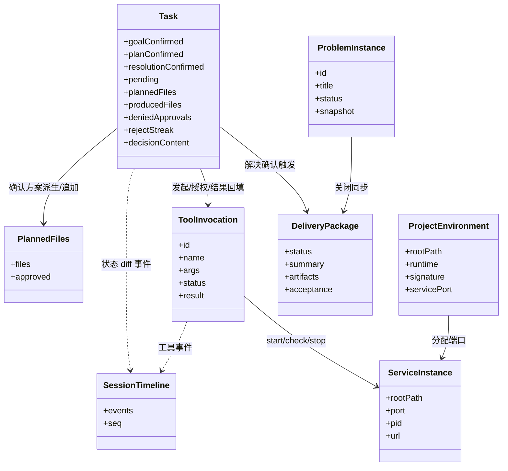

# 06 · 聚合设计（DDD Aggregates）

> 阶段：战术 / Aggregates
> 输入：[04 限界上下文](04-bounded-contexts.md) 的通用语言、[05 上下文映射](05-context-map.md) 的契约与失败模式
> 输出：聚合目录、不变量表、实体/值对象清单、事务边界、跨聚合一致性、仓储接口草案、工厂与 Specification

---

## 1. 聚合目录

| 编号 | 聚合                                         | 聚合根               | 所属上下文           | 包含实体                                                | 包含值对象                                                                                                                                                                                                                  | 关键不变量 | 关键命令                                                                                                                                                                                                           |
| :--- | :------------------------------------------- | :------------------- | :------------------- | :------------------------------------------------------ | :-------------------------------------------------------------------------------------------------------------------------------------------------------------------------------------------------------------------------- | :--------- | :----------------------------------------------------------------------------------------------------------------------------------------------------------------------------------------------------------------- |
| A1   | **任务（Task）**                             | `ConversationState`  | BC-01 会话与任务     | 无（状态机聚合；消息/回合是外部读模型）                 | `GoalProposal`、`PlanProposal`、`CompletionClaim`、`CompletionEvidence`、`VerificationItem`、`ApprovalRequest`、`RejectReason`、`ActionAttribute`、`DecisionContent`、`SystemClarifyProposal`、`TurnProgress`、`StuckState` | I01-I09    | `ProposeGoal`、`ConfirmGoal`、`RejectGoal`、`ProposePlan`、`ConfirmPlan`、`RejectPlan`、`ProposeCompletion`、`ConfirmResolution`、`RejectResolution`、`SetPending`、`ApproveTool`、`RejectTool`、`ApplyToolResult` |
| A2   | **计划清单（PlannedFiles）**                 | `PlannedFilesData`   | BC-03 工作区与环境   | `PlannedFile`（path）                                   | `FilePath`（规范化路径）                                                                                                                                                                                                    | I06、I10   | `AddPlannedFiles`、`ResetPlannedFiles`、`LoadPlannedFiles`                                                                                                                                                         |
| A3   | **工具调用（ToolInvocation）**               | `ToolCallMsg`        | BC-02 执行与信任     | `ToolCall`（一次调用生命周期）                          | `ToolResult`、`ApprovalRequest`、`ActionAttribute`、`ToolRisk`                                                                                                                                                              | I11        | `RequestTool`、`ApproveTool`、`RejectTool`、`RememberTool`、`ExecuteTool`、`CancelTool`、`RevertToolFile`                                                                                                          |
| A4   | **项目环境（ProjectEnvironment）**           | `ProjectEnvironment` | BC-03 工作区与环境   | 无                                                      | `RuntimeStatus`、`Capability`、`CapabilityStatus`、`EnvironmentSignature`、`Port`                                                                                                                                           | I16        | `DetectEnvironment`、`EnsureEnvironment`、`AllocatePort`、`ReleasePort`、`CheckCapability`、`RecordCapabilityResult`                                                                                               |
| A5   | **服务实例（ServiceInstance）**              | `ServiceEntry`       | BC-03 工作区与环境   | `ServiceProcess`（pid）                                 | `ServiceUrl`、`Port`                                                                                                                                                                                                        | I12        | `StartService`、`CheckService`、`StopService`、`StopAllServices`                                                                                                                                                   |
| A6   | **问题实例（ProblemInstance）**              | `ProblemInstance`    | BC-04 交付与问题台账 | `ProblemSnapshot`（目标/决策/授权/待办）                | `ProblemStatus`、`AuthorizedOperation`、`ProblemId`                                                                                                                                                                         | I13        | `CreateProblem`、`RerunProblem`、`UpdateProblemSnapshot`、`CloseProblem`                                                                                                                                           |
| A7   | **交付包（DeliveryPackage）**                | `DeliveryPackage`    | BC-04 交付与问题台账 | `DiffChange` / `DiffFile`                               | `AcceptanceItem`、`ArtifactRef`、`RerunEntry`、`DeliveryStatus`                                                                                                                                                             | I14        | `BuildDeliveryPackage`、`AcceptArtifact`、`ApplyDiff`、`RevertDiff`、`CloseDelivery`                                                                                                                               |
| A8   | **会话时间线（SessionTimeline）**            | `SessionTimeline`    | BC-06 会话时间线     | `TimelineEvent`（按 seq 追加）                          | `TimelineEventType`、`TimelineEventSpec`、`EventDetail`、`DedupeKey`                                                                                                                                                        | I15        | `AppendEvent`、`QueryEvents`、`ValidateEvent`                                                                                                                                                                      |
| A13  | **变更集（ChangeSet）**（目标态）            | `ChangeSet`          | BC-10 变更与版本     | `ChangeItem`（path、baseHash、afterHash、hunks）        | `ChangeId`、`BaseSnapshotRef`、`BaseHash`、`ChangeStatus`、`DiffHunk`                                                                                                                                                       | I17        | `ProposeChangeSet`、`ReviewChangeItem`、`ApplyChangeSet`、`RevertChangeSet`、`SupersedeChangeSet`                                                                                                                  |
| A14  | **任务队列条目（TaskQueueEntry）**（目标态） | `TaskQueueEntry`     | BC-11 任务编排       | `QueueEntry`（taskRef、position）                       | `TaskEntryId`、`TaskPriority`、`QueueStatus`、`SchedulingPolicy`                                                                                                                                                            | I18        | `EnqueueTask`、`StartTask`、`PauseTask`、`ResumeTask`、`CancelTask`、`ReorderTask`                                                                                                                                 |
| A15  | **用量台账（UsageLedger）**（目标态）        | `UsageLedger`        | BC-12 用量与成本     | `UsageEntry`（request、model、tokens、cache、cost）     | `UsageEntryId`、`TokenCount`、`Money`、`PriceTableVersion`、`CacheOutcome`                                                                                                                                                  | I19        | `RecordUsage`、`EvaluateBudget`、`ClosePeriod`、`ExportUsage`                                                                                                                                                      |
| A16  | **扩展（Extension）**（目标态）              | `Extension`          | BC-13 扩展与集成     | 无（描述符 + 生命周期状态）                             | `ExtensionId`、`ExtensionVersion`、`ExtensionKind`、`CapabilityDescriptor`、`TrustLevel`                                                                                                                                    | I20        | `RegisterExtension`、`ActivateExtension`、`DeactivateExtension`、`InvokeCapability`                                                                                                                                |
| A17  | **验收记录（AcceptanceRecord）**（目标态）   | `AcceptanceRecord`   | BC-14 验收与质量门禁 | `AcceptanceItem`（source、status、evidenceRef、waiver） | `AcceptanceSource`、`AcceptanceStatus`、`EvidenceRef`、`WaiverReason`、`GateVerdict`                                                                                                                                        | I21        | `DeriveAcceptanceCriteria`、`AttachEvidence`、`MarkPassed`、`WaiveItem`、`EvaluateGate`                                                                                                                            |

> **非聚合的支持对象**：`ProviderDescriptor`（值对象/配置）、`ResolvedModelMap`（网关内存派生）、`ChatLogEntry`（时间线子集）、`PrefixCacheState`（缓存）、`RagHit`/`ContextFragment`（瞬时值对象）、`SceneCard`（产品内容）。它们有生命周期，但不承担聚合根的一致性职责。
> A13-A17 是**目标态聚合**，其推导来源为占位/字段/文案证据；五个聚合已于 2026-11-14 全部落地（见 I17-I21 的代码锚点）。

---

## 2. 不变量表

| 编号 | 不变量                                                                                                                                                                                                              | 触发命令                                                              | 校验位置                                                                                                                                                                      | 违反时行为                                                                                                                               |
| :--- | :------------------------------------------------------------------------------------------------------------------------------------------------------------------------------------------------------------------ | :-------------------------------------------------------------------- | :---------------------------------------------------------------------------------------------------------------------------------------------------------------------------- | :--------------------------------------------------------------------------------------------------------------------------------------- |
| I01  | **状态推进只能由用户决策发生**；模型只能提议                                                                                                                                                                        | `ConfirmGoal/Plan/Resolution`、`Reject*`、`ApproveTool/RejectTool`    | `userDecided` / `approvalDecided`（`conversationState.ts`）；`useConversationState.transition` 是唯一写入口                                                                   | 其他函数不得直接改确认位；测试 `Inv 1` 锁定                                                                                              |
| I02  | **决策点唯一**：按 `goal > plan > approval > resolution` 优先级返回单一 `PendingKind`                                                                                                                               | `DeriveDecisionPoint`                                                 | `deriveDecisionPoint`（`conversationState.ts`）                                                                                                                               | 多提议并存时高优先级胜出；测试 `Inv 2/Inv 7`                                                                                             |
| I03  | **门控顺序**：`SessionGate` 先于 `ActionGate`；`pending` 非 none 冻结一切工具（含只读）                                                                                                                             | 任意工具请求                                                          | `sessionGate` / `actionGate` / `canExecute`（`conversationState.ts`）；main `ToolRegistry.execute`（`tools.ts`）                                                              | 拒绝并返回可执行引导；测试 `Inv 3`                                                                                                       |
| I04  | **无证据不对账**：完成声明必须有非空 verification，且至少一条系统可代跑只读命令；planned 必须全部产出                                                                                                               | `ReportCompletion`                                                    | `evidenceVerifiable` / `verifyCompletion`（`conversationState.ts`）；`verification.ts`（`runOne`）                                                                            | 不进入 resolution；返回 `missing/unverifiable`；回填引导；测试 `Inv 4`                                                                   |
| I05  | **推进保障**：pending/未确认/失败诊断/有推进 → auto；确认后无推进且工具可用 → require-action；工具不可用 → require-advance                                                                                          | 每轮发送                                                              | `decideProgressGuarantee`（`conversationState.ts`）                                                                                                                           | 只改变强制模式，不直接改任务确认位；测试 `Inv 5`                                                                                         |
| I06  | **方案清单单一来源**：`plannedFiles` 只由已确认的 `PlanProposal.files` 或 `approve-files` 派生；追加去重；拒绝不落清单                                                                                              | `ConfirmPlan`、`ApproveFiles`、`RejectPlan`                           | `derivePlannedFiles`（`conversationState.ts`）；`PlannedFilesStore.add`（`plannedFilesStore.ts`）                                                                             | 拒绝方案不得把提案文件写入清单；任务边界重置清空；测试 `Inv 6` + 本次修复                                                                |
| I07  | **单一 PENDING**：同一时刻只有一个决策点；`setPending` 覆盖而非叠加                                                                                                                                                 | `SetPending`                                                          | `setPending`（`conversationState.ts`）                                                                                                                                        | 旧决策点被覆盖；`decisionContent` 只保留最新；测试 `Inv 7`                                                                               |
| I08  | **拒绝必须带原因**：拒绝决策必须携带 `RejectReason`；`modify` 视为拒绝 + 修正内容                                                                                                                                   | `Reject*`、`ApprovalRejected`                                         | `userDecided` / `approvalDecided` 运行时 throw                                                                                                                                | 无原因拒绝抛 `TypeError`；测试 `Inv 8`                                                                                                   |
| I09  | **任务边界重置**：goal 确认清空 planned/produced/filesApproved/denied/lastToolFailed；resolution 确认重置 planConfirmed                                                                                             | `ConfirmGoal`、`ConfirmResolution`                                    | `userDecided`（`conversationState.ts`）；`clearTrust`（`ConversationPanel.tsx`）                                                                                              | 新任务的计划/产出/拒绝记忆不得继承；测试 `Inv 1/Inv 6`                                                                                   |
| I10  | **计划清单追加幂等**：重复文件不重复；空数组 no-op；`approved` 随 add 置 true，reset 置 false                                                                                                                       | `AddPlannedFiles`、`ResetPlannedFiles`                                | `PlannedFilesStore`（`plannedFilesStore.ts`）                                                                                                                                 | 损坏 JSON → 空清单；落盘失败 → 内存态仍工作；测试 `plannedFilesStore.test.ts`                                                            |
| I11  | **工具调用安全边界**：write/edit 写前快照；requiresApproval 工具必须 approved；bash 只读才可自动；沙箱外写入逐次授权；低危委托仅限**已批准方案清单内 write/edit**（根内 realpath，main 二次校验）；拒绝记忆同类短封 | `ExecuteTool`                                                         | `ToolRegistry.execute` / `delegationBoundaryViolation`（`tools.ts`）；`classifyReadonly` / `isSideEffectAction`；`shouldAutoApproveTool`（`authModel.ts`）；`useToolApproval` | 未授权 → `needApproval`；策略引导 → `policy`；委托越界 → `security.trust_delegation_denied` + 授权卡；回滚恢复原样；测试 `tools.test.ts` |
| I12  | **服务实例唯一**：每个 rootPath 最多一个服务；端口避开宿主保留端口 5173/5175；只停 NeonForge 自己起的进程                                                                                                           | `StartService`、`StopService`                                         | `serviceManager.ts`（`stopServer`/`stopAllServices`）；`envManager.ts`                                                                                                        | 已有服务 → 返回既有；保留端口 → 杀进程 + 拒绝；pid=0 → 不得 kill（本次修复）                                                             |
| I13  | **问题状态机 7 态**：问题 = 一等公民；关闭只能在交付确认后；同标题复跑更新原实例；台账最多 20 条                                                                                                                    | `CreateProblem`、`RerunProblem`、`CloseProblem`                       | `problemStore.ts`；`SessionPanel.tsx`；`MainWorkspace.tsx`                                                                                                                    | 非法状态转换不得写入；旧 `authorized` 字符串迁移为结构化                                                                                 |
| I14  | **交付包真实性**：交付包只能由真实 write/edit 变更和用户确认解决驱动；验收项全勾选才能关闭；demo 注入不得进产品路径                                                                                                 | `BuildDeliveryPackage`、`ConfirmClose`                                | `MainWorkspace.tsx`、`DeliveryPanel.tsx`（门禁）                                                                                                                              | 无真实变更 → 不生成交付包；演示仅在 demo bridge 存在时渲染                                                                               |
| I15  | **时间线追加有序**：事件按会话独立 `seq` 单调递增；事件 type 必须在注册表；`card.shown` 等按 dedupe key 只记一次；append-only JSONL                                                                                 | `AppendEvent`                                                         | `timeline.ts`、`timelineLogger.ts`（`logTimeline`）                                                                                                                           | 未注册事件 warn；坏行读取时跳过；写失败计数可见 + DLQ 重放（P1-02）                                                                      |
| I16  | **环境事实单源**：环境签名变化才重新检测；端口分配避开保留端口与已用端口；能力从环境派生不重复 exec                                                                                                                 | `EnsureEnvironment`、`AllocatePort`、`CheckCapability`                | `envManager.ts`                                                                                                                                                               | 签名相同复用；端口保留；能力状态 ready/missing/failed                                                                                    |
| I17  | **变更集可追溯**：每个变更项必须有应用前基线（快照/哈希）；应用必须用户审核授权；应用前校验基线，不一致 → `conflicted`；回滚恢复基线                                                                                | `ProposeChangeSet`、`ApplyChangeSet`、`RevertChangeSet`               | `domain/changeSet.ts`（`ChangeSet`）、`main/changeSetService.ts`                                                                                                              | 无基线不得应用；冲突不得静默覆盖；回滚失败显式报告                                                                                       |
| I18  | **队列单活跃**：每个工作区同时最多一个 `running`；阻塞任务不得自动跳过或自动确认；取消不破坏 Task 状态                                                                                                              | `StartTask`、`PauseTask`、`CancelTask`                                | `domain/taskQueue.ts`（`TaskQueueEntry`）、`main/taskQueueStore.ts`                                                                                                           | 重复启动拒绝；阻塞保持 `blocked`；取消走 BC-01/BC-02 取消路径                                                                            |
| I19  | **用量真实且不可变**：只记录 Provider 返回的 usage；缺失记 `unknown`；条目不可修改；不含内容/密钥；未知价格不得按 0                                                                                                 | `RecordUsage`、`EvaluateBudget`                                       | `domain/usageLedger.ts`（`UsageLedger`）、`main/usageStore.ts`                                                                                                                | 无 usage → `unknown`；重算产生新条目；导出脱敏                                                                                           |
| I20  | **扩受控**：只有已注册且 active 的扩展能力可调用；生命周期幂等；第三方首次调用需授权；不得绕过 BC-02 沙箱/授权                                                                                                      | `RegisterExtension`、`InvokeCapability`                               | `domain/extension.ts`（`Extension`）、`main/pluginSystem.ts`、`main/mcpManager.ts`                                                                                            | 未知扩展拒绝；失败隔离；能力描述与风险等级校验                                                                                           |
| I21  | **验收有据**：验收项必须有来源；passed 必须有证据引用； waived 必须有理由；门禁 = 所有非豁免项 passed；无来源显式为空                                                                                               | `DeriveAcceptanceCriteria`、`MarkPassed`、`WaiveItem`、`EvaluateGate` | `domain/acceptance.ts`（`AcceptanceRecord`）、`main/acceptanceStore.ts`                                                                                                       | 无来源不得伪造“全部通过”；failed/pending 不放行关闭；演示 DoD 不进生产                                                                   |

---

## 3. 实体与值对象清单

| 名称                    | 类型       | 所属聚合        | 标识策略 / 相等性定义                                                                                          |
| :---------------------- | :--------- | :-------------- | :------------------------------------------------------------------------------------------------------------- |
| `ConversationState`     | 聚合根状态 | A1 Task         | 会话/任务级单实例；不可变转换返回新对象                                                                        |
| `GoalProposal`          | 值对象     | A1              | 按 `statement + assumptions` 值相等；假设为 `Assumption`（ADR-014）                                            |
| `PlanProposal`          | 值对象     | A1              | 按 `summary + files + assumptions + verificationPlan` 值相等；假设为 `Assumption`（ADR-014）                   |
| `PlanFileEntry`         | 值对象     | A1              | 按 `path + reason` 值相等                                                                                      |
| `Assumption`            | 值对象     | A1              | 按 `text + source` 值相等；`source ∈ model_inference/user_choice/clarification`（ADR-014）                     |
| `TrustMode`             | 值对象     | A3              | `strict/standard/delegated` 三档预设（ADR-015）；main `trustPolicyStore` 持久化，renderer `authModel` 判定单源 |
| `CompletionClaim`       | 值对象     | A1              | 按 `summary + evidence` 值相等                                                                                 |
| `CompletionEvidence`    | 值对象     | A1              | 按 `verification + diffs + pendingQuestions` 值相等                                                            |
| `VerificationItem`      | 值对象     | A1              | 按 `command + output + passed` 值相等                                                                          |
| `ApprovalRequest`       | 值对象     | A1/A3           | 按 `toolName + subject + reason + risk` 值相等                                                                 |
| `RejectReason`          | 值对象     | A1              | 按 `kind + text + target` 值相等                                                                               |
| `ActionAttribute`       | 值对象     | A1/A3           | 按 `kind + basis` 值相等                                                                                       |
| `DecisionContent`       | 值对象     | A1              | 按 `kind + proposal/approval + since` 快照；决策呈现唯一来源                                                   |
| `SystemClarifyProposal` | 值对象     | A1              | 按 `underlying + statement` 值相等                                                                             |
| `TurnProgress`          | 值对象     | A1              | 每轮评估快照；字段布尔/计数                                                                                    |
| `StuckState`            | 值对象     | A1              | 不可变；`consecutiveNoProgress + escalations`                                                                  |
| `PlannedFilesData`      | 聚合根状态 | A2              | 按 `files` 集合 + `approved` 布尔；持久化权威                                                                  |
| `ToolCallMsg`           | 聚合根状态 | A3              | 按稳定 `id` 标识一次工具调用；旧存档 fallback name+args                                                        |
| `ToolResult`            | 值对象     | A3              | 按 `ok + data/error + needApproval/policy`                                                                     |
| `ProjectEnvironment`    | 聚合根状态 | A4              | 按 `rootPath` 标识；`signature` 判定新鲜度                                                                     |
| `Capability`            | 值对象     | A4              | 按 `id` 标识；`category/status/implementations/requires`                                                       |
| `ServiceEntry`          | 聚合根状态 | A5              | 按 `rootPath` 标识；`pid/port/url/startedAt`                                                                   |
| `ProblemInstance`       | 聚合根状态 | A6              | 按 `id` 标识；`title/status/snapshot/updatedAt`                                                                |
| `ProblemSnapshot`       | 值对象     | A6              | 按 `goal + decisions + authorized + pending` 快照                                                              |
| `AuthorizedOperation`   | 值对象     | A6              | 按 `tool + file` 结构化相等                                                                                    |
| `DeliveryPackage`       | 聚合根状态 | A7              | 按交付包实例（renderer state）；`status` 三态                                                                  |
| `AcceptanceItem`        | 值对象     | A7              | 按 `label + done`                                                                                              |
| `DiffChange`            | 值对象     | A7              | 按 `line + type + content`                                                                                     |
| `TimelineEvent`         | 实体       | A8              | 按 `session + seq` 唯一；`ts` 为时间                                                                           |
| `TimelineEventSpec`     | 值对象     | A8              | 按 `domain + role + detailKeys + dedupe`                                                                       |
| `ProviderDescriptor`    | 值对象     | BC-05（非聚合） | 按 `id` 标识；纯数据                                                                                           |
| `ContextFragment`       | 值对象     | BC-08（非聚合） | 按 `path + content + truncated`                                                                                |
| `RagHit`                | 值对象     | BC-08（非聚合） | 按 `path + line + snippet`                                                                                     |

---

## 4. 事务边界说明

### 4.1 默认规则

- **一个事务修改一个聚合**。Task 的状态转换在 renderer 内存中同步完成；一次 `transition(fn)` 只产生一个新 `ConversationState`，不直接修改 PlannedFiles、Problem、Delivery、Timeline。
- 跨聚合传播通过 **领域事件**（`deriveStateEvents` → `timeline:log`）或 **显式 IPC 命令**（`planned-files:add`、`session:plan-confirmed`、`completion:verify`、`delivery:apply-diff`）。
- 副作用工具（write/edit/bash）执行前必须先完成：授权判定 → 快照 → 执行 → 结果回填。工具执行本身是独立事务（外部副作用不可回滚，只能靠快照补偿）。

### 4.2 例外条件

| 例外    | 说明                                                    | 处理                                                                                             |
| :------ | :------------------------------------------------------ | :----------------------------------------------------------------------------------------------- |
| A1 → A2 | 方案确认需要在同一用户动作后派生并落盘计划清单          | 先更新 Task，再调用 `planned-files:add`；失败不阻断 Task 确认，但需在 UI/日志可见                |
| A1 → A3 | 工具结果需要回填 Task 的 `producedFiles/lastToolFailed` | `applyToolResult` 作为 Task 的转换；工具执行本身是 A3 事务                                       |
| A6 ↔ A7 | 交付包关闭需要同步问题台账状态                          | `handleConfirmClosed` 同时更新 DeliveryPackage + ProblemInstance；两者都是 UI 状态，允许最终一致 |
| A4 → A5 | 端口分配与服务实例                                      | 先 `allocatePort` 再 `startServer`；失败释放端口                                                 |
| A8      | 所有聚合的事件                                          | append-only；不参与业务事务回滚                                                                  |

### 4.3 并发 / 锁策略

- **流式链互斥**：`acquireChain()` 串行化 send / 授权续聊，防止 chunk 交错（`useChatEngine.ts` 的 `acquireChain`）。
- **会话隔离**：`sessionRef` 递增，旧会话事件/续流失效。
- **工具卡定位**：按稳定 `id` 更新，避免同 args 多卡错位。
- **服务注册表**：按 `rootPath` 唯一，启动前查已有。
- **文件写入**：写前快照；无文件锁；外部并发修改靠 diff 应用失败/回滚。
- **计划清单落盘**：`writeFileSync` 覆盖，非原子 rename（见 08 建议）。

---

## 5. 跨聚合一致性策略

| 场景                                 | 触发事件                                                                          | 补偿方式                                                    | 幂等保障                         | 重试策略                  |
| :----------------------------------- | :-------------------------------------------------------------------------------- | :---------------------------------------------------------- | :------------------------------- | :------------------------ |
| Task 确认方案 → PlannedFiles 落盘    | `task.plan_confirmed`（语义 plan；旧名 `task.execution_confirmed`）               | 落盘失败不阻断；下次 `planned-files:add` 追加               | `add` 去重；空数组 no-op         | 用户下次批准/重启恢复     |
| Task 解决确认 → DeliveryPackage      | `task.resolution_confirmed`（语义 resolution；旧名 `task.achievement_confirmed`） | 交付包由真实 `realChanges` 重建；无变更不生成               | 以文件去重；同一任务重复确认覆盖 | 重新执行/复跑             |
| Task 解决确认 → ProblemInstance      | 用户确认关闭                                                                      | 如果不关闭，问题保持 delivered/executing                    | 同标题复跑更新原实例             | 手动重试                  |
| ToolInvocation → Task producedFiles  | `tool.executed`                                                                   | 工具成功才入 produced；失败置 `lastToolFailed`；policy 不置 | 文件集合去重                     | 模型重试/换方案           |
| ToolInvocation → Workspace 文件      | write/edit 成功                                                                   | `.nf-bak` 快照回滚                                          | 快照覆盖同文件                   | 用户点回滚                |
| ProjectEnvironment → ServiceInstance | `start-server`                                                                    | 端口分配失败释放；服务失败杀进程                            | rootPath 唯一                    | `check-capability` 后重试 |
| ProblemInstance → DeliveryPackage    | 问题关闭                                                                          | 两处状态同步；交付包 status closed                          | 关闭幂等                         | 重新打开/复跑             |
| 任意聚合 → SessionTimeline           | 状态 diff / 工具事件                                                              | 日志写失败不影响业务；无补偿                                | dedupe key；seq per session      | 无自动重试（缺口）        |

---

## 6. 仓储接口草案

> 只定义语义契约，不包含 SQL/ORM/具体存储。

| 聚合                  | 仓储接口                                                            | 方法（语义）                                                                                                         | 查询边界                                                                                    |
| :-------------------- | :------------------------------------------------------------------ | :------------------------------------------------------------------------------------------------------------------- | :------------------------------------------------------------------------------------------ |
| A1 Task               | `ITaskRepository`（renderer sessionSnapshot）                       | `toTaskSnapshot(state)`；`fromTaskSnapshot(raw)`；`loadSessionSnapshot()`/`saveSession(msgs, task)`/`clearSession()` | localStorage `nf-session` V2（消息 + TaskSnapshot 同一记录原子写，ADR-013；旧 V1 数组兼容） |
| A2 PlannedFiles       | `PlannedFilesRepository`                                            | `load() → {files, approved}`；`add(files) → {files, approved}`；`reset() → {files, approved}`                        | 当前任务/会话；损坏回退空；落盘 userData                                                    |
| A3 ToolInvocation     | `ToolInvocationRepository`（当前无独立仓储；由消息状态/时间线承担） | `recordRequest(call)`；`recordResult(callId, result)`；`findByMessage(msgId)`                                        | 会话内；按稳定 id                                                                           |
| A4 ProjectEnvironment | `EnvironmentRegistry`                                               | `get(rootPath)`；`register(env)`；`ensure(rootPath)`；`allocatePort(rootPath)`；`releasePort(rootPath)`              | 进程内；rootPath 级                                                                         |
| A5 ServiceInstance    | `ServiceRegistry`                                                   | `get(rootPath)`；`start(rootPath, cmd)`；`check(rootPath)`；`stop(rootPath)`；`list()`                               | 进程内；rootPath 唯一                                                                       |
| A6 ProblemInstance    | `ProblemRepository`                                                 | `load(fallback)`；`save(list)`；`create(text)`；`updateSnapshot(problem, patch)`                                     | localStorage；最多 20 条                                                                    |
| A7 DeliveryPackage    | `DeliveryRepository`（当前为 renderer state + IPC）                 | `build(changes, acceptance)`；`applyDiff(path, diff, approved)`；`revertDiff(path)`；`close()`                       | 当前问题/交付包                                                                             |
| A8 SessionTimeline    | `TimelineRepository`                                                | `append(event)`；`query(filter)`                                                                                     | 按 session/type/from/to/limit；JSONL                                                        |
| BC-05 Provider        | `ProviderRegistry`                                                  | `list()`；`get(id)`；`isProviderId(id)`                                                                              | 静态注册表                                                                                  |
| BC-07 Config          | `ConfigRepository`                                                  | `hasValidKey()`；`getApiKey()`；`setApiKey()`；`getProviderId()`；`getModelId()`；`getWebAccess()`；`setWebAccess()` | 本机 userData；密钥加密/明文 fallback                                                       |
| BC-08 Context         | `ContextProvider`                                                   | `resolve(rootPath, files)`；`search(rootPath, query)`；`compact(history)`；`preheat(prefix)`                         | 瞬时/进程内                                                                                 |
| BC-03 Workspace       | `WorkspaceRepository`                                               | `openFolder()`；`listDir()`；`readFile()`；`readNotebook()`；`initProject()`；`updateProjectTitle()`                 | 本地文件系统；rootPath                                                                      |

---

## 7. 工厂清单

| 工厂 / 方法                                   | 创建目标             | 创建条件                            | 验证规则                                            | 初始状态                                    |
| :-------------------------------------------- | :------------------- | :---------------------------------- | :-------------------------------------------------- | :------------------------------------------ |
| `initialState()`                              | Task 聚合            | 会话开始/恢复失败                   | 所有确认位 false，planned/produced 空，pending none | 见 `conversationState.ts`（`initialState`） |
| `pendingProposal(kind, proposal, since)`      | `DecisionContent`    | 协议工具成功                        | kind 与 proposal 类型匹配；since 由调用方提供       | `pending` 置位，内容快照                    |
| `parsePlanProposal(text)`                     | `PlanProposal`       | 文本降级通道                        | `【执行方案】` 块 + 合法路径行；否则 `ok:false`     | 无决策点（降级）                            |
| `parseCompletionClaim(text)`                  | `CompletionClaim`    | 文本降级通道                        | `【已达成】` 块；命令行/结果解析                    | 无决策点（需证据门）                        |
| `detectEnvironment(rootPath)`                 | `ProjectEnvironment` | 项目打开/环境检查                   | runtime/包管理器/工具链/签名                        | `servicePort=0`                             |
| `detectCapabilities(rootPath, platform, env)` | `Capability[]`       | `check-capability`                  | 平台原生 + 外部扩展；ready/missing/failed           | 状态由环境派生                              |
| `buildStandardPrefix(rootPath, files)`        | `StandardPrefix`     | 打开项目                            | hash 由内容计算；tokens 估算                        | 缓存未命中                                  |
| `createProblem(text)`                         | `ProblemInstance`    | 用户发送首条问题                    | 标题截断 20 字；status executing；snapshot 初始化   | 见 `problemStore.ts`（`createProblem`）     |
| `buildDeliveryPackage(changes, acceptance)`   | `DeliveryPackage`    | 真实 write/edit 成功 / 用户确认解决 | 只从真实变更生成；acceptance 可空                   | status delivered                            |
| `resolveSandboxPath(rootPath, p)`             | 规范化路径值对象     | 任意模型路径                        | 绝对路径原样；剥误带前缀；相对拼 rootPath           | 空 rootPath 原样                            |
| `classifyReadonly(name, command)`             | `ActionKind`         | 工具请求/门控                       | 只读白名单 + 危险链 + git 子命令 + 网络形态         | fail-closed（空命令 hazardous）             |
| `createGuard/createJourney`（e2e 域）         | 收敛守卫 / 旅程状态  | e2e 模拟器                          | staleLimit/totalLimit；UNTIL 终止点                 | 由测试配置                                  |

---

## 8. Specification（谓词型业务规则）

| Specification                             | 谓词形式                           | 消费方                                                        | 说明                             |
| :---------------------------------------- | :--------------------------------- | :------------------------------------------------------------ | :------------------------------- |
| `isLikelyPath(p)`                         | 给定字符串，是否为路径形态         | `parsePlanProposal`、`parseExecutionPlan`、协议参数校验       | 排除自然语言/句读/长中文无扩展名 |
| `matchesPlannedPath(q, produced)`         | 给定计划项，是否被产出覆盖         | `verifyCompletion`、`plannedComplete`、`evaluateTurnProgress` | 精确或末段边界匹配               |
| `evidenceVerifiable(evidence)`            | 给定证据，是否至少一条系统可代跑   | `deriveDecisionPoint`、`verifyCompletion`                     | 非只读 → unverifiable            |
| `plannedComplete(s, projectFiles)`        | 给定任务与文件树，计划是否全部完成 | `decideProgressGuarantee`                                     | 无计划时以 produced 为准         |
| `classifyReadonly(name, command)`         | 给定动作，是否只读/网络只读/高危   | 门控、preApproval、verification                               | fail-closed                      |
| `actionNeedsApproval(attr)`               | 给定动作属性，是否需要授权         | `deriveDecisionPoint`、`sessionGate`                          | out-of-plan/hazardous            |
| `decideProgressGuarantee(s, turn, files)` | 给定状态与回合，推进模式           | `runChat`                                                     | 唯一推进判定器                   |
| `isConsumedProposal(content, s)`          | 给定内容与确认位，提议是否已消费   | `runChat`                                                     | 防已确认提议被重复计为推进       |
| `isStructuredProposal(text)`              | 给定文本，是否含结构化提议标记     | `evaluateTurnProgress`、`isConsumedProposal`                  | 唯一文本探测                     |

---

## 9. 外部引用再审视（生命周期是否由我方管理）

| 外部引用对象                   | 我方是否管理其生命周期（创建/修改/终结）？ | 结论                                                   | 依据                                   |
| :----------------------------- | :----------------------------------------- | :----------------------------------------------------- | :------------------------------------- |
| 项目文件（用户项目根下的文件） | 是（write/edit 创建/修改，快照回滚）       | 作为 Workspace/PlannedFiles 管理的对象，不是仅 ID 引用 | `tools.ts` 执行器；`plannedFilesStore` |
| 项目根目录                     | 是（打开/初始化/切换）                     | Workspace 聚合管理                                     | `workspace.ts`                         |
| 开发服务器进程                 | 是（start/check/stop/退出清理）            | ServiceInstance 聚合管理                               | `serviceManager.ts`                    |
| 端口号                         | 是（分配/释放/保留）                       | ProjectEnvironment 端口分配器管理                      | `envManager.ts`                        |
| Provider 上游模型 id           | 否（外部供应商管理）                       | 仅作为解析结果/值对象，不提升为聚合                    | `gateway.ts`（`refreshModels`）        |
| Web 搜索端点/Key               | 是（配置/探测/覆盖）                       | ConfigStore 管理，不提升为聚合                         | `configStore.ts`、`webTools.ts`        |
| LSP 进程                       | 是（connect/stop）                         | LspService 管理，生命周期短，非聚合                    | `lsp.ts`                               |
| 聊天日志/时间线文件            | 是（append/query/export）                  | Timeline/ChatLog 管理                                  | `timelineLogger.ts`、`chatLog.ts`      |
| API Key                        | 是（加密/解密/明文 fallback）              | ConfigRepository 管理                                  | `configStore.ts`                       |

**结论**：所有“由我方管理生命周期”的外部引用都已提升为聚合或明确的管理者；Provider 上游模型、搜索端点等由外部管理的对象保持值对象/配置引用。**未发现“以外键划聚合”的反模式**。

---

## 10. 聚合关系图

> 目标态聚合关系（A13-A17）在原 as-is 图中未画入，避免与历史现状混淆；A13–A17 已于 2026-11-14 全部落地（见 §A13–A17）：`ChangeSet` 由工具变更产生并被 `DeliveryPackage` 引用；`TaskQueueEntry` 消费 `Task` 状态事件；`UsageLedger` 消费 `ChatStream` usage；`AcceptanceRecord` 消费 `PlanProposal.verificationPlan` 与完成证据，并向 `DeliveryPackage` 发布门禁结论；`Extension` 向 `ToolInvocation` 提供受控能力描述（经 BC-02 授权）。

---

## 11. 校验清单

- [x] 每个聚合至少对应 1 条显式不变量
- [x] 聚合边界说明了事务边界；默认“1 个事务修改 1 个聚合”
- [x] 跨聚合一致性有事件与补偿策略
- [x] 无“以外键划聚合”的反模式（聚合不是 ORM 关系映射）
- [x] 实体与值对象的区分有明确理由（标识 vs 值语义）
- [x] 聚合大小合理：Task 是状态机聚合，无 >5 实体；PlannedFiles/ServiceInstance 等均为小聚合
- [x] 每个外部引用都已回答过“其生命周期是否由我方管理”；答案为是者已提升为内部聚合或明确管理者
- [x] 已扫描“谓词型业务规则”并评估 Specification 模式；入选者已列为一等构造块
- [x] 目标态聚合 A13-A17（变更集/队列/用量/扩展/验收）已按同一标准补齐聚合根、不变量、命令与事件；实现状态见 `00-domain-blueprint.md`
- [x] 目标态聚合边界不与既有聚合重叠：变更集不替代交付包，队列不替代 Task，验收不替代完成证据门
