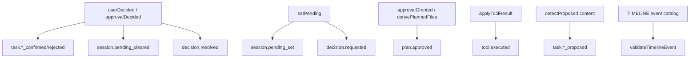
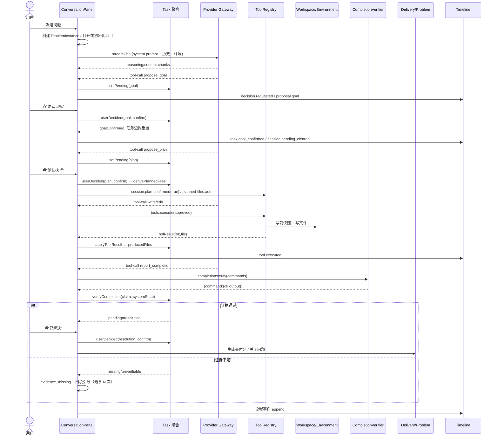

# 07 · 领域交互（DDD Domain Interactions）

> 阶段：战术 / Interactions
> 输入：[06 聚合设计](06-aggregates.md) 的聚合目录与不变量、[05 上下文映射](05-context-map.md) 的契约
> 输出：领域事件目录、集成事件契约、幂等与重放、领域服务、仓储接口、工厂、订阅者与副作用

---

## 1. 领域事件目录

> 事件名与载荷的代码权威：`apps/desktop/src/domain/timeline.ts`（`TimelineEventType`、`TIMELINE_EVENT_SPECS`）。下表按事件族组织；同一族内变体共享源聚合与消费者。

| 事件族 | 变体 | 源聚合 | 触发条件 | 关键字段 | 范围 | 消费者 |
| :--- | :--- | :--- | :--- | :--- | :--- | :--- |
| `conversation.message_sent` | — | 会话 | 用户非 silent 发送 | content | Domain | 时间线、聊天日志、UI |
| `conversation.system_nudge` | — | 会话 | 系统引导/对账注入 | content, kind | Domain | 时间线（不进用户通道） |
| `conversation.assistant_start` | — | 会话 | 模型轮开始 | forceTool, goalConfirmed, planConfirmed | Domain | 时间线、诊断 |
| `conversation.assistant_done` | — | 会话 | 流式 done | content | Domain | 时间线、聊天日志、提议检测 |
| `conversation.interrupted` | — | 会话 | 用户停止/silent 打断 | source | Domain | 时间线、UI |
| `conversation.created` | — | 会话 | 进入对话生成 UUID | session | Domain | 时间线、日志归属 |
| `conversation.status_change` | — | 会话 | working/ready/approval-pending 变化 | status | Domain | 状态栏 |
| `conversation.error` | — | 会话 | gateway/网络错误 | errorType, message | Domain | UI 重试、时间线 |
| `task.goal_proposed` | — | Task | 模型输出【目标确认】标记 | goalText | Domain | 时间线、审计 |
| `task.goal_confirmed` | — | Task | 用户确认目标 | point | Domain | 任务边界重置、UI |
| `task.goal_rejected` | — | Task | 用户拒绝目标 | point | Domain | 重提议、loop guard |
| `task.plan_proposed` | — | Task | 模型输出【执行方案】 | plan, files | Domain（旧名 `task.execution_proposed` 保留读取窗口） | 时间线、审计 |
| `task.plan_confirmed` | — | Task | 用户确认方案 | point | Domain（旧名 `task.execution_confirmed` 保留读取窗口） | 计划清单派生、交付 |
| `task.plan_rejected` | — | Task | 用户拒绝方案 | point | Domain（旧名 `task.execution_rejected` 保留读取窗口） | 重提议、loop guard |
| `task.resolution_proposed` | — | Task | 模型输出【已达成】 | summary | Domain（旧名 `task.achievement_proposed` 保留读取窗口） | 证据门 |
| `task.resolution_confirmed` | — | Task | 用户确认解决 | point | Domain（旧名 `task.achievement_confirmed` 保留读取窗口） | 交付包、问题台账 |
| `task.resolution_rejected` | — | Task | 用户拒绝解决 | point | Domain（旧名 `task.achievement_rejected` 保留读取窗口） | 重提议/继续 |
| `session.pending_set` | — | Task | 决策点置位 | kind | Domain | 时间线、UI 冻结 |
| `session.pending_cleared` | — | Task | 用户决策 | kind | Domain | 时间线、UI 解冻 |
| `dialogue.loop_guard` | — | Task | 重复/文本回复达阈值（一级） | rounds | Domain | 注入 loop-guard 文本 |
| `dialogue.forced_clarify` | — | Task | 达强制阈值（二级） | underlying | Domain | 系统强制澄清卡 |
| `dialogue.needs_human` | — | Task | 强制卡也被拒/升级耗尽（三级） | reason | Domain | 状态栏提示 |
| `plan.approved` | — | PlannedFiles | 计划清单追加（方案确认/approve-files） | files | Domain | 写门控、交付 |
| `plan.rejected` | — | PlannedFiles | 写清单外被拒 | file, approvedList | Domain | 引导补充清单 |
| `tool.requested` | — | ToolInvocation | 模型 tool_call | name, args | Domain | 时间线、工具卡 |
| `tool.blocked` | — | ToolInvocation | pending/未确认/清单外/策略拒绝 | name, gate, reason | Domain | 引导模型、审计 |
| `tool.executing` | — | ToolInvocation | 开始执行 | name, approved | Domain | 时间线 |
| `tool.executed` | — | ToolInvocation | 成功 | name, file/files | Domain | producedFiles、文件树、交付 |
| `tool.failed` | — | ToolInvocation | 失败 | name, error | Domain | `lastToolFailed`、诊断 |
| `tool.approved` | — | ToolInvocation | 用户批准 | name | Domain | 执行、信任 |
| `tool.rejected` | — | ToolInvocation | 用户拒绝 | name, args | Domain | 拒绝记忆、UI |
| `tool.remembered` | — | ToolInvocation | 允许并记住 | name, file | Domain | 任务信任 |
| `capability.checked` | — | ProjectEnvironment | check-capability | capabilities, missing | Domain | 环境注入、UI |
| `capability.ledger_updated` | — | ProjectEnvironment | bash 失败归因 | capabilityId, ok | Domain | 自学习降级 |
| `environment.injected` | — | ProjectEnvironment | 发送前注入环境快照 | rootPath, runtime, caps | Domain | 系统提示、审计 |
| `execution.forced` / `execution.released` | — | Task | 推进保障模式变化 | reason, mode | Domain | 时间线、诊断 |
| `execution.force_input` | — | Task | 取证快照 | planned, produced, projectFiles, goalAchieved | Domain | 诊断 |
| `stuck.escalated` / `stuck.needs_human` | — | Task | 无进展升级/转人工 | message | Domain | 自动续聊/状态栏 |
| `problem.created` / `problem.rerun` | — | ProblemInstance | 新问题/同标题复跑 | problemId, title | Domain | 问题台账 |
| `problem.snapshot_updated` | — | ProblemInstance | 目标/授权快照回写 | problemId, field | Domain | 台账、断点续做 |
| `problem.closed` | — | ProblemInstance | 用户确认关闭 | problemId | Domain | 台账终态 |
| `card.shown` | — | UI 卡 | 卡弹出 | card, name, args | Domain（UI 生命周期） | 时间线、去重 |
| `card.resolved` / `card.rejected` / `card.dismissed` | — | UI 卡 | 卡确认/拒绝/消失 | card, action, cause | Domain（UI 生命周期） | 时间线、审计 |
| `decision.requested` | — | Task | 决策点出现 | kind, since | Domain | UI 卡、审计 |
| `decision.resolved` | — | Task | 决策确认/拒绝 | point, action, reason | Domain | 回填模型、审计 |
| `proposal.goal` | — | Task | GoalProposal 结构化解析 | statement, assumptions | Domain | 决策点、审计 |
| `proposal.plan` | — | Task | PlanProposal 结构化解析 | ok, summary, files/reason | Domain | 决策点、审计 |
| `proposal.completion` | — | Task | CompletionClaim 结构化解析 | ok, summary, verification, pendingQuestions | Domain | 证据门、审计 |
| `proposal.clarify` | — | Task | ask_user 澄清 | question, type, options | Domain | UI 候选、审计 |
| `protocol.text_fallback` | — | Task | 文本标记降级 | marker, content_snip | Domain | 系统引导改用协议工具 |
| `completion.evidence_missing` | — | Task | 证据门拒绝 | ok, missing, unverifiable | Domain | 回填引导、用户提示 |
| `changeset.proposed` | — | ChangeSet（已实现） | 模型/工具产生真实变更 | changeId, files, baseHash | Domain | 审核 UI、交付 |
| `changeset.reviewed` | — | ChangeSet（已实现） | 用户审核变更项 | changeId, itemId, decision | Domain | 应用/回滚 |
| `changeset.applied` | — | ChangeSet（已实现） | 应用成功 | changeId, files | Domain | 交付包、工作区 |
| `changeset.reverted` | — | ChangeSet（已实现） | 回滚成功 | changeId, files | Domain | 交付包、审计 |
| `changeset.conflict_detected` | — | ChangeSet（已实现） | 基线不一致 | changeId, file, expected, actual | Domain | 阻止应用、用户提示 |
| `queue.entry_enqueued` | — | TaskQueueEntry（已实现） | 任务入队 | entryId, taskRef, position | Domain | 队列 UI、调度 |
| `queue.entry_started` | — | TaskQueueEntry（已实现） | 调度启动 | entryId, taskRef | Domain | 队列 UI、会话 |
| `queue.entry_blocked` | — | TaskQueueEntry（已实现） | 任务等待用户决策/授权 | entryId, reason | Domain | 队列 UI、用户提示 |
| `queue.entry_completed` | — | TaskQueueEntry（已实现） | 任务完成/失败/取消 | entryId, outcome | Domain | 队列 UI、审计 |
| `queue.entry_resumed` / `queue.entry_paused` / `queue.entry_cancelled` / `queue.entry_reordered` | — | TaskQueueEntry（已实现） | 队列状态变化 | entryId, position? | Domain | 队列 UI、审计 |
| `usage.recorded` | — | UsageLedger（已实现） | 收到 Provider usage | entryId, provider, model, tokens, cache, cost | Domain | UI 用量、审计 |
| `usage.budget_threshold_reached` | — | UsageLedger（已实现） | 达到用户预算阈值 | period, spent, limit | Domain | 用户提醒（不硬中断） |
| `extension.registered` / `extension.activated` / `extension.deactivated` | — | Extension（已实现） | 扩展生命周期 | extensionId, kind, version | Domain | 插件 UI、工具目录 |
| `extension.invocation_denied` | — | Extension（已实现） | 未注册/未激活/未授权调用 | extensionId, capability, reason | Domain | 安全审计、用户提示 |
| `acceptance.criteria_derived` | — | AcceptanceRecord（已实现） | 从方案/DoD 派生验收项 | recordId, source, items | Domain | 交付 UI、门禁 |
| `acceptance.item_passed` / `acceptance.item_failed` / `acceptance.item_waived` | — | AcceptanceRecord（已实现） | 验收项判定 | recordId, itemId, evidenceRef/reason | Domain | 门禁、交付 |
| `quality_gate.evaluated` | — | AcceptanceRecord（已实现） | 门禁计算 | recordId, verdict, blockingItems | Domain | 关闭前置、交付包 |

### 1.1 事件派生关系

---

## 2. 集成事件契约（IPC）

> IPC 是本地进程间契约，不是对外网络 API；但它是 BC 之间唯一的运行时集成通道，按“集成契约”治理。

| 契约 | 方向 | 请求 | 响应 / 事件 | 幂等性 | 失败模式 | Owner |
| :--- | :--- | :--- | :--- | :--- | :--- | :--- |
| `gateway:stream-chat` | renderer → main | apiKey, level, tools, forceTool, messages | `{ok,error,errorType}`；流经 `gateway:stream-chunk` | 否（每次请求新流） | 401/5xx/超时/网络；3 次重试 | BC-05 |
| `gateway:stream-chunk` | main → renderer | — | `{type: reasoning/content/tool-call/done/stream-reset, text?, toolCall?}` | 事件；`stream-reset` 丢弃半截 | 半包 JSON、tool_call 截断 | BC-05 |
| `gateway:validate` | renderer → main | apiKey, providerId, modelId | `{ok,error,suggestModelId,modelSource}` | 是（只验证） | key-invalid/region-blocked/service/timeout/network | BC-05 |
| `gateway:active-model` | renderer → main | — | providerId/label/upstream/shortName | 是 | 无 | BC-05 |
| `tools:list` | renderer → main | — | `{name,source,requiresApproval,risk}[]` | 是 | 无 | BC-02 |
| `tools:execute` | renderer → main | name, args, approved, rootPath, sessionId | `{ok,data,error,needApproval?,policy?}` | 部分（bash 非幂等；write/edit 可回滚） | 未授权/拦截/执行失败 | BC-02 |
| `tools:revert` | renderer → main | path | `{ok,error}` | 是（恢复快照） | 无快照 | BC-02 |
| `tools:cancel` | renderer → main | — | `{ok,error}` | 是 | 无活动命令 | BC-02 |
| `planned-files:load` | renderer → main | — | `{files,approved}` | 是 | 损坏 → 空 | BC-03 |
| `planned-files:add` | renderer → main | files | `{files,approved}` | 是（追加去重） | 落盘失败静默 | BC-03 |
| `planned-files:reset` | renderer → main | — | `{files,approved}` | 是 | 清理快照失败忽略 | BC-03 |
| `session:plan-confirmed` | renderer → main | boolean | void | 是 | 无 | BC-02 |
| `completion:verify` | renderer → main | commands, rootPath | `Record<command,{ok,output}>` | 是（只读命令） | 非只读跳过；超时 5s；输出 4KB | BC-02/BC-03 |
| `delivery:apply-diff` | renderer → main | path, diff, approved | `{ok,file,error}` | 部分（快照后应用） | 未授权/解析空/文件不存在 | BC-04/BC-03 |
| `delivery:revert-diff` | renderer → main | path | `{ok,error}` | 是 | 无快照 | BC-04/BC-03 |
| `workspace:open-folder` | renderer → main | — | rootPath/null | 是 | 取消/失败 | BC-03 |
| `workspace:list-dir` | renderer → main | dirPath | `DirEntry[]` | 是 | 无权限/不存在 → 空 | BC-03 |
| `workspace:read-file` | renderer → main | filePath | `{ok,content}\|{ok:false,error}` | 是 | 非文件/过大/读失败 | BC-03 |
| `workspace:read-notebook` | renderer → main | rootPath | `{ok,content}\|null` | 是 | 不存在 → null | BC-03 |
| `workspace:init-project` | renderer → main | title | `{ok,path,title}` | 否（创建目录） | 同名自动序号；失败 | BC-03 |
| `workspace:update-project-title` | renderer → main | path, title | `{ok,error}` | 是 | README/package 缺失 | BC-03 |
| `context:resolve` | renderer → main | files | `{fragments:[{path,content,truncated}]}` | 是（读取） | 缺失/不可读跳过 | BC-08 |
| `rag:search` | renderer → main | query | `{hits,note?}` | 是 | 无项目/空关键词 | BC-08 |
| `compaction:compact` | renderer → main | history | `{ok,summary,kept}\|{ok:false,error}` | 是（阈值未到返回错误） | 无 Key/摘要失败 | BC-08 |
| `preheat:status` | renderer → main | — | `{plan,cache,preheat}` | 是 | 无 | BC-08 |
| `timeline:log` | renderer → main | session,type,role,detail | void | 是（事件） | 写失败静默 | BC-06 |
| `timeline:query` | renderer → main | filter | `TimelineEvent[]` | 是 | 文件缺失 → 空 | BC-06 |
| `chat:log` / `chat:export` | renderer → main | entry / — | void / `{ok,path,error}` | 是（追加/固定覆盖） | 写失败静默/无记录 | BC-06 |
| `config:*` | renderer → main | key/provider/model/web patch | 配置值/操作结果 | 是（覆盖写） | 解密失败/落盘失败 | BC-07 |
| `plugins:list` / `plugins:toggle` | renderer → main | — / name,active | 插件列表 / boolean | 是 | 未注册 → false | BC-09 |
| `changeset:list/revert/clear` + `delivery:apply-diff/revert-diff`（已实现） | renderer → main | sessionId | 变更集 / 回滚结果 | revert 带基线校验；clear 幂等 | 未授权/冲突/快照缺失 | BC-10 |
| `queue:enqueue/list/start/block/resume/pause/complete/fail/cancel/reorder/clear`（已实现） | renderer → main | sessionId/title/entryId/reason/position | 队列状态 | 命令按 entryId；list 是查询 | 重复启动/状态漂移 | BC-11 |
| `usage:summary/export` + `budget:get/set`（已实现） | renderer → main | sessionId/settings | 用量汇总 / 预算状态 / 导出路径 | 查询只读；set 幂等 | 无 usage/导出失败 | BC-12 |
| `extensions:list/toggle/authorize` + `mcp:config/save/refresh/status` + `git:read`（已实现） | renderer → main | extensionId/active/servers | 扩展列表 / 连接结果 / Git 只读数据 | 生命周期幂等；refresh 有并发保护 | 未注册/未授权/连接失败 | BC-13 |
| `acceptance:derive/list/mark/waive/apply-evidence/evaluate/accept-empty/clear`（已实现） | renderer → main | sessionId/itemId/status/evidenceRefs | 验收记录 / 门禁结论 | derive 按任务边界重写；mark 需证据/理由 | 无来源/证据缺失/豁免无理由 | BC-14 |

---

## 3. 幂等与重放策略

| 对象 | 幂等键 / 去重键 | 去重窗口 | 重放规则 | 异常处理 |
| :--- | :--- | :--- | :--- | :--- |
| PlannedFiles 追加 | 文件路径集合 | 任务边界内 | `add` 去重；重复文件不重复 | 落盘失败 → 内存态仍工作 |
| 授权拒绝记忆 | `toolName + subject` | 任务边界内 | 同类动作直接 deny | 任务边界（goal 确认）重置 |
| 时间线 `card.shown` | `type + JSON(detail)` | 会话内 | `dedupeKey` 只记一次 | 未使用全局去重存储（缺口） |
| 流式重试 | `stream-reset` | 单次请求内 | 丢半截流，重拉 | 3 次后失败；已推 delta 需 reset |
| 工具调用 | 稳定 `ToolCallMsg.id` | 消息内 | 按 id 更新；旧存档 fallback name+args | id 丢失 → 不 patch，防误伤 |
| 完成证据 | `command`（结果表 key） | 单次核验 | 同一命令覆盖结果 | 非只读跳过；超时/截断 |
| 证据回填引导 | `evidenceGuideCountRef` | 任务内 | 有 missing 最多 1 次，仅 unverifiable 最多 3 次 | 超限 → 用户侧提示 |
| 问题复跑 | 标题 | 台账内 | 同标题更新原实例，不新增 | 标题截断可能误合并（风险） |
| 会话恢复 | 消息 `id` | 会话内（最多 50） | 只存完整消息；streaming 不覆盖 | 损坏 → 空会话 |
| 服务启动 | `rootPath` | 进程内 | 已有服务直接返回 | 失败释放端口 |
| Diff 应用 | 路径 + diff 内容 | 单次操作 | 应用前快照；逐条状态 | 解析空/文件不存在 → 错误 |
| 压缩 | 消息数/字符阈值 | 每次 send | 压缩结果写回 messages state | 失败 → 全量发送 |
| 预热 | 前缀 hash | 缓存历史 20 | hash 相同命中，不重建 | 失败 → 下次再试 |

---

## 4. 领域服务定义

| 领域服务 | 职责 | 输入 | 输出 | 依赖聚合/事件 | 不应包含的逻辑 |
| :--- | :--- | :--- | :--- | :--- | :--- |
| `DecisionPointDeriver`（`deriveDecisionPoint`） | 状态 × 提议 × 动作 → 唯一决策点 | state、proposals、pendingActions、userRequested | `PendingKind \| 'none'` | Task | 不弹卡、不写 UI、不调模型 |
| `ProgressEvaluator`（`evaluateTurnProgress`） | 从工具调用与内容评估本轮进展 | toolCalls、content、prevReadFiles、planned/produced/projectFiles | `TurnProgress` | Task、ToolInvocation | 不判升级、不发送续聊 |
| `StuckDetector`（`detectStuck`） | 连续无进展 → 事件（no-progress/escalate/needs-human） | TurnProgress、StuckState、阈值 | 新 StuckState + event | Task | 不注入文本、不改任务确认位 |
| `UnproductiveDialogueDetector`（`detectUnproductiveDialogue`） | 检测重复决策点/文本回复/总轮 | state、turnCount | loop-guard/forced-clarify/null | Task | 不直接置 pending（由应用层置 system_clarify） |
| `CompletionVerifier`（`verifyCompletion`） | 证据完整性 + 系统代跑结果 + planned 对账 | claim、SystemVerifier | `{ok,missing,unverifiable}` | Task、PlannedFiles、Verification | 不执行命令（V1a 在 main） |
| `ActionClassifier`（`classifyReadonly`） | 工具调用 → readonly/network-read/hazardous | name、command | `ActionKind` | ToolInvocation | 不查用户权限、不执行 |
| `GateEvaluator`（`sessionGate`/`actionGate`/`canExecute`） | 会话门 + 动作门 + 拒绝记忆 | state、action、inPlanned、policy | `{ok,reason}` / verdict | Task、ToolInvocation、PlannedFiles | 不弹卡、不执行 |
| `EvidenceBackfiller`（`buildEvidenceBackfill`） | 证据不足 → 可执行回填引导文本 | verify result | string | Task | 不发送消息（应用层发送） |
| `PermissionRuleEngine`（`matchesRule`/rules） | deny > allow > ask；规则匹配 | tool、args、rule | boolean/action | ToolInvocation | 不决定风险等级 |
| `SandboxPathNormalizer`（`resolveSandboxPath`） | 模型路径 → rootPath 基准 | rootPath、path | normalized path | Workspace | 不做文件存在性检查 |
| `ToolExecutor`（ToolRegistry） | 工具查找、授权、执行、结果结构化 | name、args、approved、rootPath | `ToolResult` | ToolInvocation、Workspace、Environment | 不做任务决策 |
| `EnvironmentDetector` | 检测项目环境 | rootPath | `ProjectEnvironment` | ProjectEnvironment | 不做能力语义分类 |
| `CapabilityRegistry` | 平台原生能力 + 外部能力 | rootPath、platform、env | `Capability[]` | ProjectEnvironment | 不安装依赖 |
| `ServiceLifecycleManager` | start/check/stop、端口/进程 | rootPath、command | ServiceEntry / result | ServiceInstance、Environment | 不执行任意 bash |
| `ProcessLifecycleManager` | 子进程/PID/进程组清理 | pid/cmd | kill/record | Platform | 不杀非自己记录的进程 |
| `ModelRouter` | thinking/userRequestedPro → flash/pro | task | `ModelTier` | Provider | 不解析上游模型 id |
| `ToolCallRepairer` | 畸形 tool_call 参数修复 | raw、round | parsed/null | Provider | 不执行工具 |
| `StreamRetryPolicy` | 400/5xx/超时/网络重试与 reset | error、attempt、emitted | retry/throw | Provider | 不改业务状态 |
| `ContextAssembler` | @mention → 文件片段 | rootPath、files | `ContextPayload` | Workspace | 不做语义检索 |
| `CodeRetriever` | 关键词检索 | rootPath、query | `RagHit[]` | Workspace | 不建向量索引（V1） |
| `LspClient` | 符号/引用/类型/诊断 | path、symbol | LSP result | Workspace | 不读全文件上下文 |
| `Compactor` | 阈值判定 + 摘要 + 保留最近 20 | history、summarize | compaction result | Provider | 不决定任务状态 |
| `Preheater` | 标准前缀 + 缓存 + 预热 | rootPath、files | PrefixCacheState / PreheatStatus | Provider | 不阻塞发送 |
| `DeliveryDiffService` | diff 解析/应用/回滚/快照 | path、diff、approved | result | Workspace | 不做验收判定 |
| `ProblemLedgerService` | 创建/更新/复跑/关闭/持久化 | text、patch、id | ProblemInstance | ProblemInstance | 不决定任务状态 |
| `TimelineLogger` | append/query JSONL | event/filter | void/events | SessionTimeline | 不重写业务事件 |
| `ConfigRepositoryService` | 密钥/provider/web 配置 | key/patch | config values | Config | 不验证网络可达性（由 gateway/web probe） |
| `PluginRegistry` | 注册/激活/停用内置插件 | plugin | PluginInfo | Platform | 不实现功能 |

---

## 5. 仓储接口清单

见 [06 §6](06-aggregates.md#6-仓储接口草案)。补充说明：

| 仓储 | 实现 | 持久化 | 事务性 | 失败语义 |
| :--- | :--- | :--- | :--- | :--- |
| `PlannedFilesRepository` | `PlannedFilesStore` | `userData/config/planned-files.json`（实际路径由 `plannedFilesStore.instance.ts` 构造） | 同步覆盖写 | 损坏 → 空清单；落盘失败 → 内存态 |
| `ProblemRepository` | `problemStore` | localStorage `nf-problems` | 同步 JSON | 损坏/不可用 → fallback |
| `SessionRepository` | `sessionStore` | localStorage `nf-session` | 同步 JSON | 损坏/不可用 → null |
| `TimelineRepository` | `timelineLogger` | `userData/logs/timeline-<session>.jsonl` | append | 写失败静默；坏行跳过 |
| `ChatLogRepository` | `chatLog` | `userData/logs/chat-<session>.jsonl` | append | 写失败静默 |
| `ConfigRepository` | `ConfigStore` | `userData/config/neonforge-config.json` | 同步 JSON，0600 | 解密失败 → 明文 fallback；损坏 → 空配置 |
| `WorkspaceRepository` | `WorkspaceService` | 本地文件系统 | 非事务 | 读取失败 → error；初始化失败 → error |
| `ServiceRegistry` | `serviceManager` | 进程内 Map | 非持久 | 重启丢失；应用退出清理 |
| `EnvironmentRegistry` | `envManager` | 进程内 Map | 非持久 | 签名变化重检 |
| `ProviderRegistry` | `providers/registry` | 静态数组 | 只读 | unknown id → throw |

---

## 6. 工厂清单

见 [06 §7](06-aggregates.md#7-工厂清单)。补充：

| 工厂 | 目标 | 说明 |
| :--- | :--- | :--- |
| `pendingProposal(kind, proposal, since)` | `DecisionContent` | 协议工具 → 决策内容；since 由调用方注入，保持纯函数 |
| `resolveFromList(providerId, ids)` | `Record<ModelTier,string>` | `/models` 列表 → flash/pro；列表无 DeepSeek 走 fallback/manual |
| `classifyGatewayError(e)` | `GatewayErrorType` | 401 → key-invalid；其余 → service/unknown |
| `buildEvidenceBackfill(v)` | 回填文本 | 纯函数，不发送 |
| `dedupeKey(type, detail)` | 事件去重键 | 纯函数 |
| `deriveStateEvents(prev, next)` | 领域事件列表 | 纯函数，转换后 diff |

---

## 7. 订阅者与副作用

| 事件 | 订阅者 | 触发动作 | 补偿策略 | 监控指标 |
| :--- | :--- | :--- | :--- | :--- |
| `task.plan_confirmed`（语义 PlanConfirmed；旧名 `task.execution_confirmed`） | ConversationPanel / main gate / PlannedFiles | 派生 plannedFiles；`session:plan-confirmed(true)`；`planned-files:add` | 失败重试；任务边界 reset | 计划清单数量、落盘失败率 |
| `task.resolution_confirmed`（语义 ResolutionConfirmed；旧名 `task.achievement_confirmed`） | MainWorkspace / Delivery | 生成交付包；问题快照；planConfirmed 重置 | 由真实 `realChanges` 重建；无变更不生成 | 交付包生成率、空验收率 |
| `task.goal_confirmed` | MainWorkspace / ConversationPanel | 任务边界重置、README 标题回写、goalSeq | 失败不阻断；下次确认重试 | 边界重置成功率 |
| `tool.executed` | ConversationPanel / MainWorkspace | producedFiles、文件树刷新、realChanges、交付包 | 快照回滚 | 工具成功率、产出文件数 |
| `tool.failed` | Task / StuckDetector / UI | `lastToolFailed`、诊断、模型修正 | 重试/换方案 | 失败率、重复失败率 |
| `decision.requested` | ConversationPanel | 弹卡、pending 冻结 | 卡消失/确认/拒绝 | 决策点数量、等待时长 |
| `decision.resolved` | ConversationPanel / 时间线 | 回填模型、清除 pending、记录原因 | 重新提议/强制澄清 | 拒绝原因分布 |
| `completion.evidence_missing` | ConversationPanel | 系统回填引导、计数 | 超限提示用户 | 证据不足率、回填成功率 |
| `dialogue.loop_guard` | ConversationPanel | 注入 loop-guard 文本 | 下一轮仍未提交 → forced clarify | loop guard 触发率 |
| `dialogue.forced_clarify` | ConversationPanel | 系统强制澄清卡 | 用户点卡重置/重新描述 | 强制澄清率 |
| `stuck.escalated` | ConversationPanel | silent 续聊指出没动手 | 2 次后 needs-human | 停滞升级率 |
| `capability.checked` / `environment.injected` | ConversationPanel | 环境快照注入系统提示、能力状态 | 失败不阻断发送 | 缺失能力率 |
| `plan.approved` / `plan.rejected` | ConversationPanel / main gate | 写边界放行/拒绝 + 引导 | 补充清单/改写清单内 | 清单外写入拒绝率 |
| `gateway:stream-chunk` | ConversationPanel | 流式 UI、tool_call 事件、done 通知 | stream-reset + 重试 | 首 token 延迟、错误率 |
| 任意领域事件 | TimelineLogger | append JSONL | 写失败静默（缺口） | 事件丢失率（当前不可观测） |
| `problem.created/rerun/closed` | SessionPanel / Delivery | 台账状态、复跑入口 | 重新打开/复跑 | 问题关闭率 |
| `chat:export` | SettingsPanel | 导出 Markdown | 固定覆盖 | 导出成功率 |

---

## 8. 主路径时序图

---

## 9. 当前交互层的缺口

1. **轻量 Outbox 已实现（2026-11-15）**：`logTimeline` 先写入 `timeline-outbox.jsonl`（fsync），再投递会话时间线；失败保留、启动重放、`outboxId` 幂等。完整跨存储事务（状态落库与事件入队同一事务）仍待建设（设计预留）。
2. **没有事件版本字段**：已修复（P2-07）——`TimelineEvent` 增加 `eventId`/`version`（当前 1）。
3. **时间线写失败静默**：已修复（P1-02）——失败计数可见 + DLQ 落盘 + 启动重放。
4. **`dedupeKey` 函数存在但全局去重存储未落地**：已修复（P2-06）——`timelineLogger` 按会话 + 类型 + detail 签名去重。
5. **IPC 不是事件总线**：`invoke` 是命令/查询语义；main→renderer 的 stream 是事件；两者混用，未区分 Command/Query/Event。
6. **领域事件与 UI 事件并存**：`card.*` 与 `decision.*` 语义重叠（前者 UI 生命周期，后者领域决策），需要文档明确边界（已写）。
7. **旧事件名**：已修复（P2-01）——规范名 `task.plan_*` / `task.resolution_*` 已启用，旧名保留读取窗口。
8. **事件重复**：已修复（P2-05）——产出增量改为 `task.files_produced`，`tool.executed` 只表示工具执行事实。
9. **没有契约 schema 校验**：IPC 参数只靠 TypeScript 类型 + 运行时零散校验；preload 没有生成式 schema。
10. **目标态领域尚未接线**：已修复——BC-10～BC-14 已落地领域事件与 IPC 契约（见 00 §3、09 design §10）。
11. **验收与完成证据语义重叠**：已修复（BC-14）——完成证据回答“是否做到”，验收回答“按什么标准算做到”，两者分属 A17 与完成证据核验。

这些缺口在 08 中作为问题清单与回溯触发项，在 09 的 design.md 中给出改进建议。
